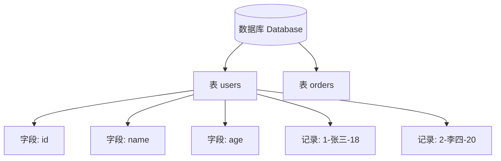

---
{"dg-publish":true,"permalink":"/计算机相关技术知识/03-数据库/数据库基础概念/","title":"数据库基础概念","tags":["数据库/基础"],"dg-note-properties":{"title":"数据库基础概念","created":"2026-10-13","tags":["数据库/基础"],"aliases":["数据库简介","Database 基础"]}}
---

# 数据库基础概念

## 什么是数据库

**数据库**（Database）是一个**结构化的数据集合**，它可以被多个用户或应用程序共享，并支持各种数据操作，如查询、插入、更新和删除等。

数据库是**数据持久化**的主要场所之一，通常与**数据库管理系统**（DBMS，Database Management System）一起使用，以便有效地存储、管理和保护数据。

## 数据库的优点

| 优点 | 说明 |
|------|------|
| **结构化存储** | 数据存储在结构化的表格或文档中，组织和管理更加有序和高效 |
| **数据共享** | 多个用户或应用程序可以同时访问和修改数据，实现共享和协作 |
| **数据完整性** | 通过约束、触发器、存储过程等机制确保数据的完整性和一致性 |
| **数据安全** | DBMS 提供用户认证、权限控制、数据加密等安全措施，保护数据安全和隐私 |

## 数据库基本概念

| 概念 | 说明 |
|------|------|
| **库**（Database） | 存放多张表的容器 |
| **表**（Table） | 类似 Excel 表格，有行有列 |
| **字段**（Column） | 表的**列**（姓名、年龄、学号等） |
| **记录**（Row） | 表的**每一行数据** |
| **SQL** | 操作数据库的语言（增删改查） |

> [!example] Excel 类比
> 一个数据库 = 一个 Excel 文件；一张表 = 一个 Sheet；字段 = 列标题；记录 = 每一行数据。

## 常见数据库类型

见 [[计算机相关技术知识/03-数据库/常见数据库类型\|常见数据库类型]] — MySQL、SQL Server、Oracle、MongoDB 对比。

## 相关笔记

- [[计算机相关技术知识/03-数据库/常见数据库类型\|常见数据库类型]] — 四大常见数据库
- [[计算机相关技术知识/03-数据库/MySQL 入门与连接\|MySQL 入门与连接]] — 从理论到 MySQL 实操
