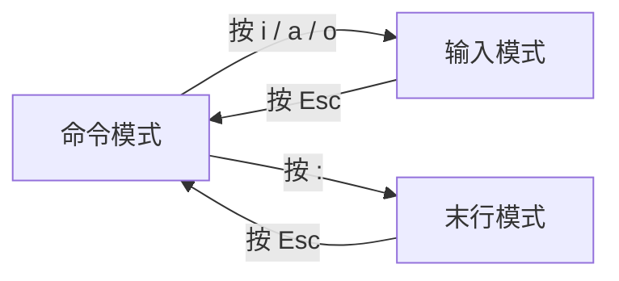

---
{"dg-publish":true,"permalink":"/计算机相关技术知识库/01-Linux/Linux vim 文本编辑/","title":"Linux vim 文本编辑","tags":["Linux/编辑器"],"dg-note-properties":{"title":"Linux vim 文本编辑","created":"2026-10-13","tags":["Linux/编辑器"],"aliases":["vim 教程","vi 编辑器"]}}
---


# Linux vim 文本编辑

`vi` 是老式基础版，`vim` 是 vi 的升级增强版（Vi IMproved）。Linux 中最常用的文本编辑器。

```bash
vi filename       # 打开/创建文件
vim filename      # 打开/创建文件（推荐）
```

## 三种工作模式

| 模式 | 说明 |
|------|------|
| **命令模式**（Command Mode） | 打开文件**默认进入**的模式，用于执行复制、删除、跳转等操作 |
| **输入模式**（Insert Mode） | 用于编辑、写入文件内容 |
| **末行模式**（Last Line Mode） | 用于执行保存、退出、查找、替换等全局操作 |

## 模式切换



- **打字、改内容**：按 `i` / `a` / `o` 键切换到输入模式，左下角会显示 `-- INSERT --`
  - `i`：在光标前插入
  - `a`：在光标后插入
  - `o`：在当前行下方新开一行插入
- **想保存、退出、全局操作**：按 `:` 键切换到末行模式，左下角会出现冒号
- **任何模式下，按 `Esc` 键**都能立刻回到命令模式——这是**万能返回键**

## 末行模式常用操作

在末行模式（按 `:` 后）执行保存文件及退出 vi 编辑器：

| 命令 | 作用 |
|------|------|
| `:w` | 保存 |
| `:q` | 退出 |
| `:wq` | 保存并退出 |
| `:q!` | 强制退出不保存 |

> [!tip] 新手最常遇到的场景
> 改了文件但不知道自己在哪个模式 → 狂按 `Esc` 回到命令模式，再输入 `:wq` 保存退出，或 `:q!` 放弃修改退出。

## 相关笔记

- [[计算机相关技术知识库/01-Linux/Linux 文件与目录操作\|Linux 文件与目录操作]] — touch / vi / vim 创建文件
- [[计算机相关技术知识库/04-速查表/Linux 命令速查\|Linux 命令速查]] — 常用命令一页速查
