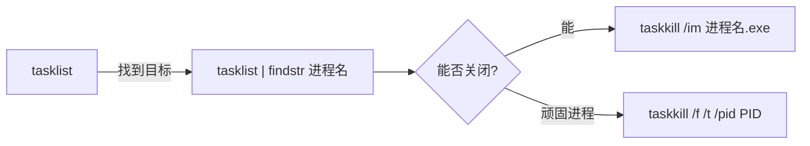

---
{"dg-publish":true,"permalink":"/计算机相关技术知识库/02-Windows/Windows 进程管理/","title":"Windows 进程管理","tags":["Windows/进程"],"dg-note-properties":{"title":"Windows 进程管理","created":"2026-10-13","tags":["Windows/进程"],"aliases":["tasklist","taskkill"]}}
---


# Windows 进程管理

## 查看进程（tasklist）

```bash
tasklist                       # 显示进程信息
tasklist | findstr notepad     # 过滤查找某个进程
```

## 结束进程（taskkill）

```bash
taskkill /im notepad.exe        # 结束名为 notepad.exe 的进程
taskkill /f /pid 1234           # 根据 PID 强制关闭
taskkill /f /im cmd.exe         # 强制结束所有名为 cmd.exe 的进程
```

## taskkill 常用参数

| 参数 | 全称 | 含义 | 说明 |
|------|------|------|------|
| `/im` | image | 进程名 | 根据**名字**杀进程 |
| `/pid` | process ID | 进程号 | 根据 **PID** 杀进程 |
| `/f` | force | 强制 | 强制杀死（关不掉就加它） |
| `/t` | tree | 进程树 | 连**子进程**一起杀 |

## 典型工作流



> [!example] 示例：彻底结束某进程及其子进程
> ```bash
> tasklist | findstr java        # 1. 找到 java 进程的 PID
> taskkill /f /t /pid 5678       # 2. 强制结束该进程及其整个进程树
> ```

> [!note] 对比 Linux
> - `tasklist` ≈ Linux 的 `ps -aux`
> - `taskkill` ≈ Linux 的 `kill`
> - `/t`（进程树）≈ 需要手动逐个杀子进程

## 相关笔记

- [[计算机相关技术知识库/02-Windows/Windows 基础命令\|Windows 基础命令]] — 起点：CMD 常用基础命令
- [[计算机相关技术知识库/02-Windows/Windows 网络命令\|Windows 网络命令]] — netstat 查看端口与进程 PID 的对应关系
- [[计算机相关技术知识库/01-Linux/Linux 进程与服务管理\|Linux 进程与服务管理]] — 对比学习：Linux 进程管理
- [[计算机相关技术知识库/04-速查表/Windows 命令速查\|Windows 命令速查]] — 进程命令一页速查
