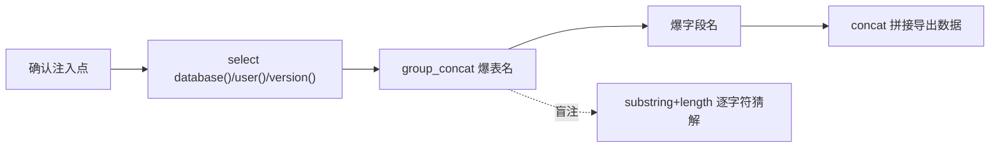

---
{"dg-publish":true,"permalink":"/计算机相关技术知识库/03-数据库/SQL 注入常用命令/","title":"SQL 注入常用命令","tags":["数据库/SQL注入","安全"],"dg-note-properties":{"title":"SQL 注入常用命令","created":"2026-10-13","tags":["数据库/SQL注入","安全"],"aliases":["SQL 注入函数","SQLi 常用命令"]}}
---


# SQL 注入常用命令

> [!warning] 合规声明
> 本页内容仅用于**授权环境下的安全测试、CTF 竞赛与防御学习**。未经授权对他人系统进行 SQL 注入属于违法行为。

SQL 注入（SQL Injection）是利用**未过滤用户输入**拼接进 SQL 语句的漏洞，使攻击者可以执行非预期的数据库操作。MySQL 是最常见的注入目标。

## 探测基本信息

注入点确认后，常用这几个函数探测目标环境：

```sql
select database();      -- 当前库名
select user();          -- 查看当前用户
select version();       -- 数据库版本号
```

> [!example] 联合注入示例
> 若页面参数存在注入，可尝试：
> ```
> ?id=1' union select 1,database(),version()--+
> ```

## 四个重要函数

| 函数 | 作用 | 示例 |
|------|------|------|
| `concat(str1, str2, ...)` | 把多个字符串**拼接成一个** | `concat(name, age)` → `张三18` |
| `group_concat(字段)` | 把**多行结果合并成一行**（爆表必用） | `group_concat(table_name)` → `user,admin,student` |
| `substring(str, start, len)` | **截取字符串**（盲注用） | `substring('abcdef', 2, 3)` → `bcd` |
| `length(str)` | 返回**字符串长度**（盲注用） | `length('admin')` → `5` |

> [!important] 为什么这几个函数关键
> - `concat`：把多列结果拼成一列输出，绕过"只回显一列"的限制
> - `group_concat`：数据库查询通常一次返回一行；`group_concat` 把多行（如所有表名）合并到一行里一次性爆出——**爆表必用**
> - `substring` + `length`：布尔/时间盲注的基石——逐字符判断猜测数据

## 典型注入链条（思路）



## 防御要点

- **参数化查询 / 预编译语句**（prepared statement）——最有效
- 严格输入校验与类型过滤
- 最小权限原则：Web 账号不要给 root 权限
- 关闭详细报错信息，防止报错注入

## 相关笔记

- [[计算机相关技术知识库/03-数据库/MySQL 增删改查\|MySQL 增删改查]] — 正常的 SQL 操作
- [[计算机相关技术知识库/03-数据库/常见数据库类型\|常见数据库类型]] — MySQL 默认端口 3306
