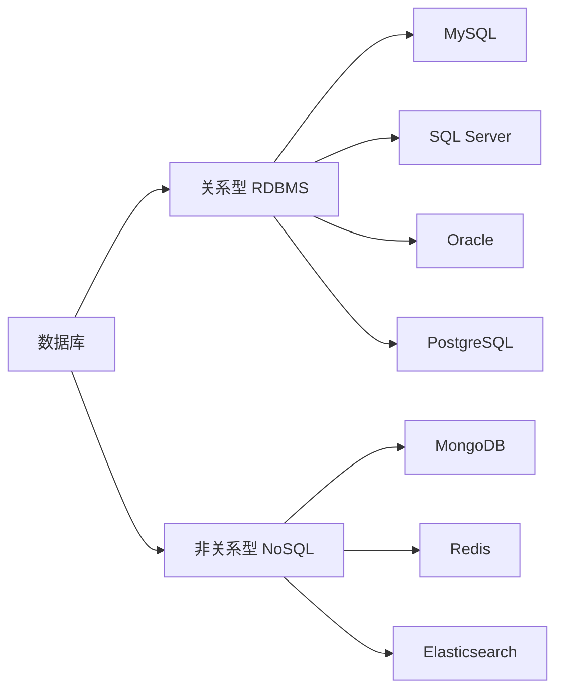

---
{"dg-publish":true,"permalink":"/计算机相关技术知识库/03-数据库/常见数据库类型/","title":"常见数据库类型","tags":["数据库/基础"],"dg-note-properties":{"title":"常见数据库类型","created":"2026-10-13","tags":["数据库/基础"],"aliases":["数据库分类","关系型数据库"]}}
---

# 常见数据库类型

## 总览对比

| 数据库 | 类型 | 默认端口 | 主要用途 | 特点 |
|--------|------|---------|---------|------|
| **MySQL** | 关系型 | 3306 | 网站后台、小程序、Java/PHP 项目 | 开源、轻量、**SQL 注入最多**；最常用，Linux/网站必用 |
| **SQL Server** | 关系型 | 1433 | Windows 服务器、.NET 项目 | 图形化强、常出现在 Windows 环境；微软常用 |
| **Oracle** | 关系型 | 1521 | 大型企业、金融系统 | 重量级、权限严格；企业、银行、政府常用 |
| **MongoDB** | 非关系型（NoSQL） | 27017 | 大数据、爬虫、日志存储 | 最流行的非关系型数据库 |

> [!important] 端口号必须记住
> 这几个默认端口在网络安全、运维排错、SQL 注入中都会反复用到：
> `3306` MySQL · `1433` SQL Server · `1521` Oracle · `27017` MongoDB

## 关系型 vs 非关系型

- **关系型**：数据存放在表中，用 SQL 操作，强调结构和一致性
- **非关系型（NoSQL）**：不使用传统表结构（文档、键值、列族等），强调灵活与扩展

## 相关笔记

- [[计算机相关技术知识库/03-数据库/数据库基础概念\|数据库基础概念]] — 库/表/字段/记录
- [[计算机相关技术知识库/03-数据库/MySQL 入门与连接\|MySQL 入门与连接]] — 重点学习 MySQL
- [[计算机相关技术知识库/03-数据库/SQL 注入常用命令\|SQL 注入常用命令]] — 为什么 MySQL 的"SQL 注入最多"
