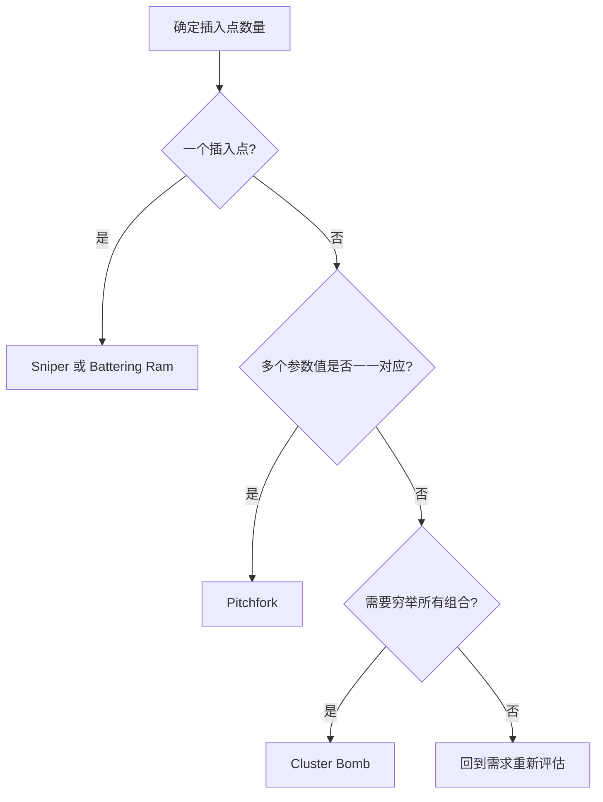

---
{"dg-publish":true,"permalink":"/计算机相关技术知识库/05-Web安全/Burp Intruder 模块/","title":"Burp Intruder 模块","tags":["Web安全/工具","Web安全/Burp"],"dg-note-properties":{"title":"Burp Intruder 模块","created":"2026-10-19","tags":["Web安全/工具","Web安全/Burp"],"aliases":["Burp 爆破模块","Intruder 攻击模式","Sniper Pitchfork Cluster Bomb"]}}
---

# Burp Intruder 模块

> [!warning] 合规声明
> 自动化爆破会产生大量请求，仅可在授权目标或本地靶场使用，避免影响业务。

Intruder 用于**自动化地向请求中注入 payload**，是暴力破解、参数模糊测试的核心模块。

## 工作要素

| 要素 | 说明 |
|------|------|
| Positions | 指定 payload 插入点（§...§） |
| Payloads | 选择 payload 类型、字典、生成规则 |
| Options | 线程、重定向、结果匹配等 |
| Attack | 启动攻击并查看结果 |

## 四种攻击模式

### Sniper（狙击手模式）

**特点**：最基础的模式，适用于**单参数**的简单测试。依次替换每一个 payload 插入点，其他位置保持不变。

**工作流程**：如果设置了多个插入点，Sniper 会先把 payload 放到第一个插入点、其余保持原样发送；再对第二个插入点重复，逐一进行。

**典型场景**：测试单个参数的注入点，如 SQL 注入、XSS、命令注入，或已知用户名爆破密码。

> [!example] 请求数量
> 3 个插入点 × 1 个 payload 集合中的 N 个值 → 共发 `3 × N` 次请求（每次只替换一个点）。

### Battering Ram（攻城锤模式）

**特点**：在**所有插入点使用同一个 payload**。

**工作流程**：取一个 payload，同时填入所有插入点并发送；再取下一个 payload，重复。

**典型场景**：多个参数需要相同输入值的场景，如测试多个输入框是否对同一特殊字符敏感。

> [!example] 请求数量
> 1 个 payload 集合中的 N 个值 → 共发 N 次请求（所有点填同一个值）。

### Pitchfork（草叉模式）

**特点**：多个插入点各用**不同的 payload 列表**，同步地从每个列表中取一个值组合发送。

**工作流程**：插入点 A 取第 1 个值，插入点 B 也取第 1 个值，一起发送；然后各取第 2 个值……如果两个列表长度不同，以较短的为准。

**典型场景**：多个参数**彼此关联**的场景，如已知用户名列表与对应密码列表的联合测试、需要同步变化的参数。

> [!example] 请求数量
> 插入点 A 有 M 个值、B 有 N 个值 → 共发 `min(M, N)` 次请求。

### Cluster Bomb（集束炸弹模式）

**特点**：对所有插入点进行**穷举式**组合，尝试每个插入点的所有可能 payload 组合。

**工作流程**：为每个插入点分别定义 payload 列表，计算所有组合并逐一发送。

**典型场景**：多个参数的所有可能组合，如**未知用户名 + 密码**的穷举、复杂表单或多层身份验证。

> [!example] 请求数量
> 插入点 A 有 5 个值、B 有 3 个值 → 共发 `5 × 3 = 15` 次请求。

**优势**：全面覆盖所有参数组合，不易遗漏。
**劣势**：请求量可能极其庞大，消耗时间和资源。

## 四种模式对比

| 模式 | payload 集合 | 插入点取值 | 请求量 | 典型场景 |
|------|-------------|-----------|--------|---------|
| Sniper | 1 个 | 每次只替换一个点 | 插入点数 × N | 单参数测试、已知用户名爆密码 |
| Battering Ram | 1 个 | 所有点填同一个值 | N | 多参数需相同输入 |
| Pitchfork | 每点一个 | 各列表同步取值 | min(M, N) | 用户名与密码一一对应 |
| Cluster Bomb | 每点一个 | 所有组合穷举 | M × N × … | 未知用户名与密码全部组合 |

## 结果分析

爆破完成后，重点看：

| 指标 | 判断方法 |
|------|---------|
| Status code | 与其他请求不同的状态码值得关注 |
| Length | 响应长度明显不同的一行通常是正确结果 |
| Response → Render | 直接查看返回页面内容确认 |
| Grep - Match | 在响应中匹配关键字，如“登录成功” |

> [!tip] 提速技巧
> - 结果列表可按 Length / Status 排序，异常值一眼可见
> - 使用 Grep-Match 自动标记含成功关键字的响应
> - 请求量大时适当提高线程，但注意目标承受能力与授权范围

## 相关笔记

- [[计算机相关技术知识库/05-Web安全/Burp Proxy 模块\|Burp Proxy 模块]] — 从 Proxy 发送请求到 Intruder
- [[计算机相关技术知识库/05-Web安全/Burp Suite 入门\|Burp Suite 入门]] — 模块总览
- [[计算机相关技术知识库/05-Web安全/暴力破解原理\|暴力破解原理]] — 爆破基础
- [[计算机相关技术知识库/05-Web安全/Burp 表单暴力破解实战\|Burp 表单暴力破解实战]] — Sniper 模式实战
- [[计算机相关技术知识库/05-Web安全/验证码与 Token 绕过\|验证码与 Token 绕过]] — Pitchfork + Recursive grep 处理 Token
- [[计算机相关技术知识库/04-速查表/Burp Suite 速查\|Burp Suite 速查]] — 四种模式速查
- [[计算机相关技术知识库/05-Web安全/Web 渗透测试概览\|Web 渗透测试概览]] — 渗透流程总览
