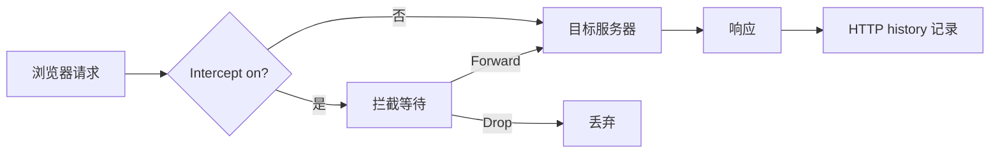

---
{"dg-publish":true,"permalink":"/计算机相关技术知识库/05-Web安全/Burp Proxy 模块/","title":"Burp Proxy 模块","tags":["Web安全/工具","Web安全/Burp"],"dg-note-properties":{"title":"Burp Proxy 模块","created":"2026-10-19","tags":["Web安全/工具","Web安全/Burp"],"aliases":["Burp 代理模块","Intercept","HTTP history"]}}
---

# Burp Proxy 模块

> [!warning] 合规声明
> 仅对授权目标使用代理拦截，不得截取、篡改他人通信数据。

Proxy 模块主要用于**拦截浏览器的 HTTP 会话内容**，并为其他模块提供数据来源。

## 四个组成部分

| 组件 | 作用 |
|------|------|
| **Intercept** | 拦截请求，可修改后放行或丢弃 |
| **HTTP history** | 记录每一个 HTTP 数据包，可回看 |
| **WebSockets history** | 记录 WebSocket 通信 |
| **Options / 其他** | 代理监听、拦截规则等配置 |

## Intercept（拦截）

- `Intercept is on / off`：开启或关闭拦截
- 开启状态下，所有符合条件的数据包都会被**拦截并等待处理**
- 抓到包后可以：
  - 修改请求内容 → 点击 **Forward** 放行
  - 点击 **Drop** 丢弃数据包

> [!tip] 常见坑
> 开启拦截后浏览器会一直转圈等待，因为请求被 Burp 截住了。忘记放行时会误以为网站卡死——先看 Burp 的 Intercept 状态。

## Action（行动）

Action 可以把 Proxy 中的数据包发送到其他模块，例如：

- Send to Intruder（爆破）
- Send to Repeater（重放）
- Send to Decoder（编解码）
- Send to Comparer（对比）

## HTTP history

HTTP history 记录了经过代理的每一个 HTTP 数据包，可用于：

- 回看历史请求与响应
- 分析站点有哪些接口、参数
- 右键任意一条记录，将数据包发送到其他模块
- 点击过滤器（Filter）设置过滤条件，只看目标站点或特定状态码

## WebSockets history

记录 WebSocket 帧的收发内容，适合分析实时通信的 Web 应用。

## 使用流程

1. 浏览器代理指向 `127.0.0.1:8080`
2. 打开目标站点，确认 HTTP history 有流量
3. 需要精细测试的请求：右键 → Send to Repeater
4. 需要批量测试的请求：右键 → Send to Intruder
5. 用 Filter 缩小范围，避免被静态资源淹没

## 相关笔记

- [[计算机相关技术知识库/05-Web安全/Burp Suite 入门\|Burp Suite 入门]] — 模块总览与代理配置
- [[计算机相关技术知识库/05-Web安全/XSS 利用与防御\|XSS 利用与防御]] — 观察 XSS 触发与 Cookie 外带
- [[计算机相关技术知识库/05-Web安全/Burp Intruder 模块\|Burp Intruder 模块]] — 把拦截到的请求送去爆破
- [[计算机相关技术知识库/05-Web安全/Burp 表单暴力破解实战\|Burp 表单暴力破解实战]] — 从 Proxy 到 Intruder 的完整流程
- [[计算机相关技术知识库/05-Web安全/验证码与 Token 绕过\|验证码与 Token 绕过]] — 在代理层删除验证码字段
- [[计算机相关技术知识库/04-速查表/Burp Suite 速查\|Burp Suite 速查]] — 操作速查
- [[计算机相关技术知识库/05-Web安全/Web 渗透测试概览\|Web 渗透测试概览]] — 渗透流程总览
