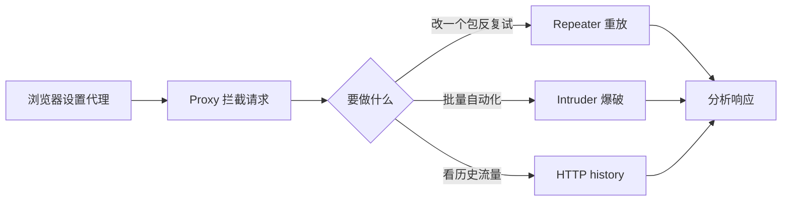

---
{"dg-publish":true,"permalink":"/计算机相关技术知识库/05-Web安全/Burp Suite 入门/","title":"Burp Suite 入门","tags":["Web安全/工具","Web安全/Burp"],"dg-note-properties":{"title":"Burp Suite 入门","created":"2026-10-19","tags":["Web安全/工具","Web安全/Burp"],"aliases":["Burp Suite","BurpSuit","抓包工具"]}}
---


# Burp Suite 入门

> [!warning] 合规声明
> Burp Suite 仅用于授权测试、靶场练习与防御研究。请通过官方渠道获取软件并遵守许可协议。

## Burp Suite 是什么

Burp Suite 是一个用于对 Web 应用程序进行攻击的**集成平台**。它通过可扩展的框架处理并显示 HTTP 消息，主要用于安全性渗透测试。

主要功能包括：

- 拦截并修改 HTTP 请求
- 扫描 Web 应用程序漏洞
- 暴力破解登录表单
- 执行会话令牌随机性检查

## 模块总览

| 模块 | 作用 | 使用频率 |
|------|------|---------|
| **Proxy** | 代理模式，默认地址 `127.0.0.1`，默认端口 `8080` | ⭐ 最常用 |
| **Intruder** | 爆破模式，自动化发送大量请求 | ⭐ 最常用 |
| **Repeater** | 请求消息重放与响应分析 | ⭐ 最常用 |
| Target | 站点目标 | 常用 |
| Spider | 爬虫模式 | 一般 |
| Scanner | 漏洞扫描（部分版本） | 一般 |
| Sequencer | 随机数分析 | 较少 |
| Decoder | 编码格式和散列转换 | 常用 |
| Comparer | 可视化差异对比 | 较少 |

## 浏览器代理配置

Burp 作为中间人，需要让浏览器把流量发给它：

1. 在浏览器中安装代理扩展 **Proxy SwitchyOmega MV3**
2. 新建情景模式，代理服务器填写 `127.0.0.1`，端口 `8080`
3. 点击【应用选项】保存
4. 在 Burp 中开启 Proxy → Intercept

```text
浏览器  →  127.0.0.1:8080（Burp Proxy）  →  目标服务器
              ↑ 拦截 / 修改 / 放行
```

> [!tip] HTTPS 抓包
> 抓 HTTPS 时需要在浏览器中信任 Burp 的 CA 证书（访问 `http://burp` 下载），否则会出现证书警告。仅在自有环境或授权测试中使用。

## Repeater（中继器）

Repeater 用于**手动修改并补发个别 HTTP 请求，并分析响应**。

> [!note] 响应是只读的
> Repeater 只能修改**请求**；服务器返回的响应在 Repeater 中只读。要修改响应，需要在 **Proxy** 中拦截响应，或使用 **Match and Replace**。

典型用法：

1. 在 Proxy 的 HTTP history 中右键请求 → **Send to Repeater**
2. 在 Repeater 中修改参数、Header、Body
3. 点击 **Send** 发送
4. 对比左侧请求与右侧响应，反复调整 payload

> [!example] 常见场景
> - 验证某个参数是否存在注入
> - 修改 `Content-Type` 测试上传校验
> - 删除验证码字段观察服务端是否校验
> - 修改 Cookie / Token 测试越权

## 典型工作流



## 相关笔记

- [[计算机相关技术知识库/05-Web安全/Burp Proxy 模块\|Burp Proxy 模块]] — 拦截、改包、历史记录
- [[计算机相关技术知识库/05-Web安全/Burp Intruder 模块\|Burp Intruder 模块]] — 四种攻击模式
- [[计算机相关技术知识库/05-Web安全/Burp 表单暴力破解实战\|Burp 表单暴力破解实战]] — 用 Intruder 爆破登录
- [[计算机相关技术知识库/05-Web安全/验证码与 Token 绕过\|验证码与 Token 绕过]] — Intruder 处理 Token
- [[计算机相关技术知识库/04-速查表/Burp Suite 速查\|Burp Suite 速查]] — 模块与操作速查
- [[计算机相关技术知识库/05-Web安全/Web 渗透测试概览\|Web 渗透测试概览]] — 渗透流程总览
- [[计算机相关技术知识库/06-网络/HTTP 请求方法\|HTTP 请求方法]] — 抓包时看到的请求方法与参数位置
