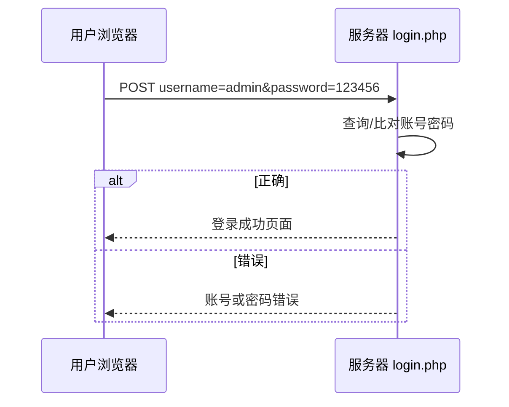

---
{"dg-publish":true,"permalink":"/计算机相关技术知识库/05-Web安全/Burp 表单暴力破解实战/","title":"Burp 表单暴力破解实战","tags":["Web安全/暴力破解","Web安全/Burp"],"dg-note-properties":{"title":"Burp 表单暴力破解实战","created":"2026-10-19","tags":["Web安全/暴力破解","Web安全/Burp"],"aliases":["表单爆破","登录爆破","pikachu 暴力破解"]}}
---


# Burp 表单暴力破解实战

> [!warning] 合规声明
> 本文操作均在 pikachu 本地靶场完成，仅用于授权教学与防御学习。

## 登录认证流程

以最简单的登录表单为例：



用户填写表单并点击登录后，浏览器会把账号密码发送到后端某个地址（如 `/pikachu/vul/burteforce/bf_form.php`），由后端代码验证是否正确。

### 简单认证模型

HTML 表单：

```html
<form action="login.php" method="POST">
    账号: <input type="text" name="username"><br/>
    密码: <input type="text" name="password"><br/>
    <button type="submit">登陆</button>
</form>
```

PHP 验证：

```php
<?php
$username = $_POST['username'];
$password = $_POST['password'];
echo $username."/".$password."\r\n";
if($username == 'admin' && $password == '123456'){
    echo "欢迎您登陆成功！";
}else {
    echo "账号或密码错误！";
}
?>
```

## pikachu 靶场

在线靶场：http://vulfocus.cn/ ，搜索并启动 pikachu。

靶场内置账号：

| # | 用户名 | 密码 |
|---|--------|------|
| 1 | admin | 123456 |
| 2 | pikachu | 000000 |
| 3 | test | abc123 |

## 基于表单的暴力破解

### 步骤

1. 打开 Burp Suite，进入 **Proxy** 界面，开启 Intercept
2. 浏览器访问 pikachu 的暴力破解页面
3. 随便输入账号密码，点击登录
4. Burp 拦截到登录请求 → 右键 **Send to Intruder**
5. 进入 **Intruder → Positions**，设置 payload 插入点
6. 进入 **Payloads**，加载密码字典
7. 点击 **Start attack** 开始爆破

### 选择攻击模式

> [!important] 前提假设
> 已知用户名是 `admin`，只需要爆破密码 → 选择 **Sniper（狙击手）** 模式，只在密码值上添加 payload 标记。

请求示例：

```http
POST /pikachu/vul/burteforce/bf_form.php HTTP/1.1
Host: 127.0.0.1
Content-Type: application/x-www-form-urlencoded

username=admin&password=§123456§&submit=Login
```

### 结果判断

爆破完成后，通过以下指标定位正确密码：

| 指标 | 判断方式 |
|------|---------|
| **Status code** | 与其他请求不同的状态码 |
| **Length** | 响应长度明显与其他行不同 |
| **Response → Render** | 直接查看返回页面，确认是否登录成功 |

> [!example] 实战判断
> 大多数响应长度接近；若某一行长度为明显异常值（如返回了登录成功页面），该行 payload 很可能就是正确密码。课件示例中命中用户名为 `admin`。

## 注意事项

- 爆破前先做**简单登录测试**，确认是否存在验证码、频率限制、账号锁定
- 请求量较大时控制线程数，避免把靶场或授权目标打挂
- 结果列表先按 Length 排序，再看 Response，可大幅减少人工排查量

## 防御要点

- 服务端验证码，且一次性使用
- 登录失败次数限制与账号临时锁定
- 异常来源 IP 限速与告警
- 强密码策略与多因素认证

## 相关笔记

- [[计算机相关技术知识库/05-Web安全/暴力破解原理\|暴力破解原理]] — 成因、危害与攻击步骤
- [[计算机相关技术知识库/05-Web安全/Burp Suite 入门\|Burp Suite 入门]] — 代理配置与模块总览
- [[计算机相关技术知识库/05-Web安全/Burp Intruder 模块\|Burp Intruder 模块]] — 四种攻击模式详解
- [[计算机相关技术知识库/05-Web安全/验证码与 Token 绕过\|验证码与 Token 绕过]] — 遇到验证码与 Token 时怎么办
- [[计算机相关技术知识库/05-Web安全/Burp Proxy 模块\|Burp Proxy 模块]] — 拦截登录请求
- [[计算机相关技术知识库/04-速查表/Burp Suite 速查\|Burp Suite 速查]] — 爆破流程速查
- [[计算机相关技术知识库/05-Web安全/Web 渗透测试概览\|Web 渗透测试概览]] — 渗透流程总览
