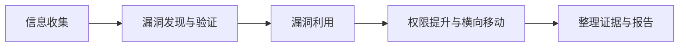

---
{"dg-publish":true,"permalink":"/计算机相关技术知识库/05-Web安全/Web 渗透测试概览/","title":"Web 渗透测试概览","tags":["Web安全/概览"],"dg-note-properties":{"title":"Web 渗透测试概览","created":"2026-10-19","tags":["Web安全/概览"],"aliases":["Web Pentest Overview","渗透测试流程"]}}
---

# Web 渗透测试概览

> [!warning] 合规声明
> 本分区内容仅用于**授权环境下的安全测试、CTF 竞赛、靶场练习与防御学习**。未经授权对他人系统进行扫描、爆破、注入或上传属于违法行为。请只在自有环境或取得书面授权的目标上实践。

Web 渗透测试的本质是**模拟攻击者的思路，在授权范围内发现并验证安全风险**。课件围绕「信息收集 → 暴力破解 → XSS → 文件上传」四条主线展开，Burp Suite 是贯穿始终的核心工具。

## 典型流程

| 阶段 | 主要工作 | 本知识库对应笔记 |
|------|---------|-----------------|
| 信息收集 | 域名、子域、端口、目录、指纹、CDN、搜索引擎语法 | [[计算机相关技术知识库/05-Web安全/信息收集总览\|信息收集总览]] |
| 工具平台 | 抓包、改包、重放、自动化测试 | [[计算机相关技术知识库/05-Web安全/Burp Suite 入门\|Burp Suite 入门]] |
| 认证攻击 | 弱口令、验证码绕过、Token 处理 | [[计算机相关技术知识库/05-Web安全/暴力破解原理\|暴力破解原理]] |
| 客户端漏洞 | 反射型 / 存储型 / DOM 型 XSS | [[计算机相关技术知识库/05-Web安全/XSS 原理与分类\|XSS 原理与分类]] |
| 服务端漏洞 | 上传 Webshell、解析绕过 | [[计算机相关技术知识库/05-Web安全/文件上传漏洞与一句话木马\|文件上传漏洞与一句话木马]] |

## 本分区导航

### 信息收集

- [[计算机相关技术知识库/05-Web安全/信息收集总览\|信息收集总览]] — 收集方向、C 段与旁站
- [[计算机相关技术知识库/05-Web安全/域名信息收集\|域名信息收集]] — 域名级别、Whois、ICP 备案、子域名
- [[计算机相关技术知识库/05-Web安全/端口扫描\|端口扫描]] — nmap、masscan、御剑
- [[计算机相关技术知识库/05-Web安全/目录信息收集\|目录信息收集]] — robots.txt、dirsearch
- [[计算机相关技术知识库/05-Web安全/网站指纹识别与 CDN\|网站指纹识别与 CDN]] — whatweb、Wappalyzer、CDN 判断
- [[计算机相关技术知识库/05-Web安全/网络空间搜索引擎语法\|网络空间搜索引擎语法]] — Google Hacking、FOFA、Quake、Hunter

### Burp Suite

- [[计算机相关技术知识库/05-Web安全/Burp Suite 入门\|Burp Suite 入门]] — 模块总览、浏览器代理、Repeater
- [[计算机相关技术知识库/05-Web安全/Burp Proxy 模块\|Burp Proxy 模块]] — 拦截、改包、HTTP history
- [[计算机相关技术知识库/05-Web安全/Burp Intruder 模块\|Burp Intruder 模块]] — 四种攻击模式

### 暴力破解

- [[计算机相关技术知识库/05-Web安全/暴力破解原理\|暴力破解原理]] — 成因、危害、攻击步骤
- [[计算机相关技术知识库/05-Web安全/Burp 表单暴力破解实战\|Burp 表单暴力破解实战]] — 登录包拦截与结果判断
- [[计算机相关技术知识库/05-Web安全/验证码与 Token 绕过\|验证码与 Token 绕过]] — 客户端/服务端验证码、Token 防爆破

### XSS

- [[计算机相关技术知识库/05-Web安全/XSS 原理与分类\|XSS 原理与分类]] — 反射型、存储型、DOM 型
- [[计算机相关技术知识库/05-Web安全/XSS 利用与防御\|XSS 利用与防御]] — Cookie 窃取与防御要点

### 文件上传

- [[计算机相关技术知识库/05-Web安全/文件上传漏洞与一句话木马\|文件上传漏洞与一句话木马]] — 漏洞成因、PHP 一句话
- [[计算机相关技术知识库/05-Web安全/Webshell 管理工具\|Webshell 管理工具]] — 蚁剑、冰蝎、菜刀、哥斯拉
- [[计算机相关技术知识库/05-Web安全/文件上传前端与 MIME 绕过\|文件上传前端与 MIME 绕过]] — Pass-01、Pass-02
- [[计算机相关技术知识库/05-Web安全/文件上传扩展名绕过\|文件上传扩展名绕过]] — 黑名单与解析技巧
- [[计算机相关技术知识库/05-Web安全/文件上传 00 截断\|文件上传 00 截断]] — GET/POST 截断

## 速查表

- [[计算机相关技术知识库/04-速查表/信息收集速查\|信息收集速查]]
- [[计算机相关技术知识库/04-速查表/搜索语法速查\|搜索语法速查]]
- [[计算机相关技术知识库/04-速查表/Burp Suite 速查\|Burp Suite 速查]]
- [[计算机相关技术知识库/04-速查表/文件上传绕过速查\|文件上传绕过速查]]
- [[计算机相关技术知识库/04-速查表/网络基础速查\|网络基础速查]]

## 相关笔记

- [[计算机相关技术知识库/首页\|首页]] — 知识库总入口
- [[计算机相关技术知识库/99-参考资料/参考资料索引\|参考资料索引]] — 原始 PDF 课件
- [[计算机相关技术知识库/03-数据库/SQL 注入常用命令\|SQL 注入常用命令]] — Web 漏洞中的 SQL 注入
- [[计算机相关技术知识库/维护指南\|维护指南]] — 新增笔记与挂链规范
- [[计算机相关技术知识库/06-网络/OSI 七层模型与 TCP-IP\|OSI 七层模型与 TCP-IP]] — 网络分层与协议基础
- [[计算机相关技术知识库/06-网络/HTTP 请求方法\|HTTP 请求方法]] — GET/POST 与请求报文基础
