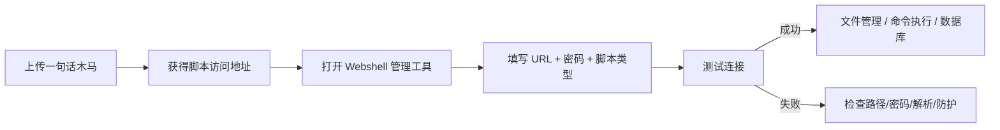

---
{"dg-publish":true,"permalink":"/计算机相关技术知识库/05-Web安全/Webshell 管理工具/","title":"Webshell 管理工具","tags":["Web安全/工具","Web安全/文件上传"],"dg-note-properties":{"title":"Webshell 管理工具","created":"2026-10-19","tags":["Web安全/工具","Web安全/文件上传"],"aliases":["蚁剑","冰蝎","哥斯拉","AntSword"]}}
---

# Webshell 管理工具

> [!warning] 合规声明
> Webshell 管理工具仅可用于授权测试、靶场练习与安全研究。用于未授权系统属于违法行为。

上传一句话木马后，手动构造 POST 请求非常繁琐。**Webshell 管理工具**可以可视化地管理远程脚本，执行命令、浏览文件、上传下载等。

## 主流工具

| 工具 | 说明 | 地址 |
|------|------|------|
| **蚁剑（AntSword）** | 开源、跨平台，国内使用广泛 | https://github.com/AntSwordProject/ |
| **冰蝎（Behinder）** | 动态二进制加密通信，流量特征较隐蔽 | https://github.com/rebeyond/Behinder |
| **菜刀（Caidao）** | 经典工具，官网已关闭，了解即可 | — |
| **哥斯拉（Godzilla）** | 支持多种加密方式与插件 | https://github.com/BeichenDream/Godzilla |

## 蚁剑（AntSword）

- 开源 Webshell 管理工具
- 支持 PHP / ASP / ASPX / JSP 等多种脚本
- 图形化界面：文件管理、虚拟终端、数据库操作、插件市场

基本使用：

1. 下载并解压蚁剑
2. 右键 → 添加数据
3. 填写 URL（一句话木马地址）与连接密码（如 `mima`）
4. 选择对应脚本类型（PHP）
5. 测试连接 → 进入文件管理 / 虚拟终端

## 冰蝎（Behinder）

- 使用动态密钥与加密通信
- 需要上传对应的加密 Webshell
- 流量不像明文 POST 那样容易被规则匹配

## 哥斯拉（Godzilla）

- 支持多种加密器与 payload
- 功能全面，插件丰富
- 需要生成对应类型的 Webshell 后上传

## 菜刀（Caidao）

- 老牌工具，官网已关闭
- 了解其存在与基本原理即可

## 连接流程

## 防御与检测

| 措施 | 说明 |
|------|------|
| 上传白名单 + 重命名 | 从源头阻止脚本落地 |
| 上传目录禁止解析 | 即使上传成功也无法执行 |
| 文件内容检测 | 检测 `eval`、`assert`、`base64_decode` 等危险函数 |
| 流量检测 | 识别蚁剑/冰蝎/哥斯拉的通信特征 |
| 文件完整性监控 | 发现 Web 目录中新增的可疑脚本 |
| 最小权限 | Web 进程使用低权限账户，限制命令执行影响 |

## 相关笔记

- [[计算机相关技术知识库/05-Web安全/文件上传漏洞与一句话木马\|文件上传漏洞与一句话木马]] — 漏洞成因与一句话木马
- [[计算机相关技术知识库/05-Web安全/文件上传前端与 MIME 绕过\|文件上传前端与 MIME 绕过]] — 上传绕过入门
- [[计算机相关技术知识库/05-Web安全/文件上传扩展名绕过\|文件上传扩展名绕过]] — 黑名单绕过
- [[计算机相关技术知识库/05-Web安全/文件上传 00 截断\|文件上传 00 截断]] — 截断上传
- [[计算机相关技术知识库/04-速查表/文件上传绕过速查\|文件上传绕过速查]] — 绕过手法速查
- [[计算机相关技术知识库/05-Web安全/Web 渗透测试概览\|Web 渗透测试概览]] — 渗透流程总览
