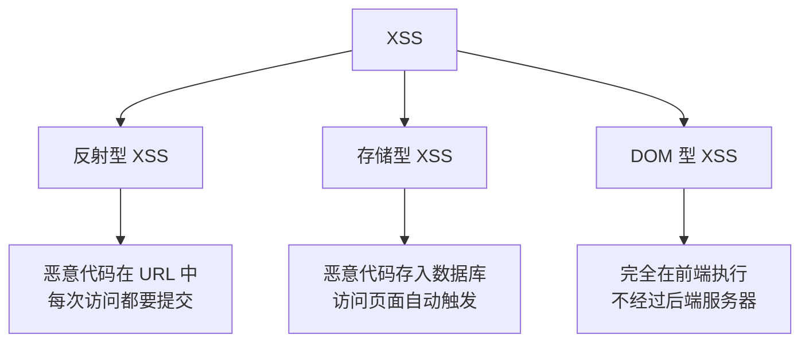
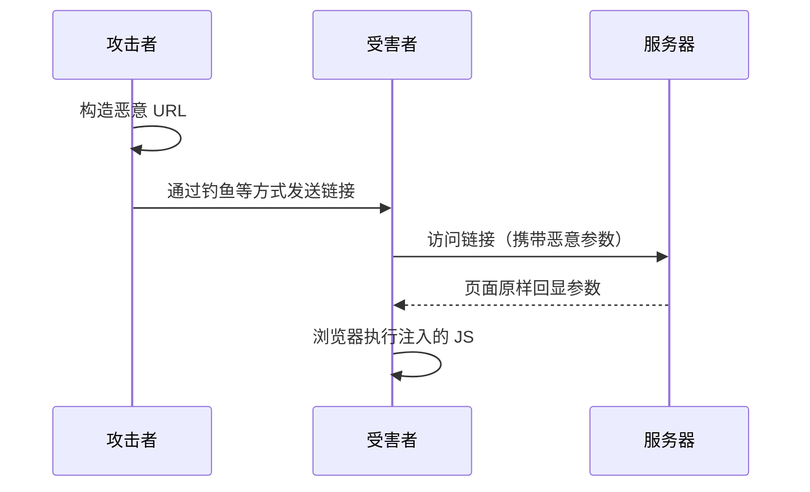
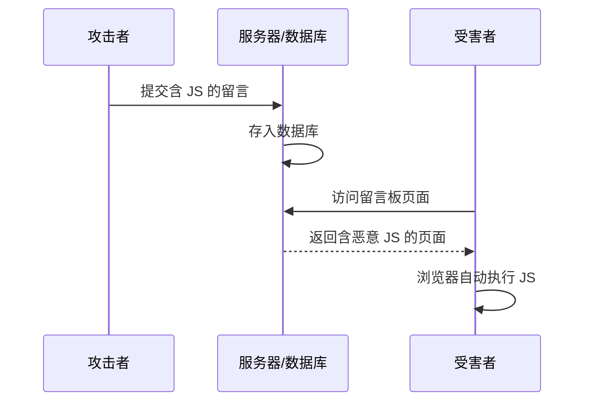

---
{"dg-publish":true,"permalink":"/计算机相关技术知识库/05-Web安全/XSS 原理与分类/","title":"XSS 原理与分类","tags":["Web安全/XSS"],"dg-note-properties":{"title":"XSS 原理与分类","created":"2026-10-19","tags":["Web安全/XSS"],"aliases":["XSS","跨站脚本攻击","Cross Site Scripting"]}}
---


# XSS 原理与分类

> [!warning] 合规声明
> XSS 测试仅可在本地靶场或取得书面授权的目标上进行。未经授权攻击他人网站属于违法行为。

## 从一个小案例说起

下面这段 PHP 代码用 GET 方式接收参数 `a`，然后原封不动输出到页面：

```php
<?php
$a = $_GET['a'];
echo $a;
?>
```

在 phpstudy 中运行后：

- 访问 `http://127.0.0.1/?a=hello` → 页面输出 `hello`
- 访问 `http://127.0.0.1/?a=<script>alert('xss')</script>` → 浏览器**弹出提示框**

这说明传入的 `<script>` 标签被浏览器当作 JavaScript 解析并执行了——这就是一个标准的 XSS 漏洞。

## XSS 简介

**XSS（Cross Site Scripting，跨站脚本攻击）**的缩写本应是 CSS，但和层叠样式表（Cascading Style Sheets）重名，因此改称 XSS。

- XSS 可以将**恶意代码注入到网页中**，从而实现攻击目的
- XSS 主要使用 **JavaScript**，JavaScript 可以非常灵活地操作 HTML、CSS 和浏览器
- XSS 产生在**前端**，受目标浏览器类型、内核版本影响（例如 IE 会检测并拦截部分 XSS）

> [!important] 一句话理解
> 只要网页把**用户可控的输入**当作 HTML/JS 输出，并且没有正确编码，就可能产生 XSS。

## XSS 的危害

XSS 执行的是 JavaScript，而 JS 能做的事情 XSS 都能做：

- 网络钓鱼，包括盗取各类用户账号
- 窃取用户 Cookie，获取隐私信息，或利用用户身份进一步操作网站
- 劫持用户（浏览器）会话，执行任意操作，如非法转账、强制发表日志、发送电子邮件
- 强制弹出广告页面、刷流量
- 进行大量客户端攻击、DDoS 攻击
- 传播跨站脚本蠕虫

## 哪里容易出现 XSS

> [!tip] 核心判断
> **只要有输出回显的地方，就都有可能产生 XSS 漏洞。**

典型场景：

| 场景 | 说明 |
|------|------|
| 搜索结果页 | 回显搜索关键词 |
| 留言板 / 评论区 | 内容被存储并展示 |
| 用户资料页 | 昵称、签名等被展示 |
| 错误提示页 | 回显用户输入 |
| URL 参数回显 | 参数直接输出到页面 |

## 三种类型

根据触发特性，XSS 分为三类：



| 类型 | 恶意代码位置 | 触发方式 | 是否经过后端 |
|------|------------|---------|-------------|
| **反射型** | URL / 请求参数 | 诱导受害者点击恶意链接 | 是 |
| **存储型** | 服务器数据库 | 受害者访问被污染的页面 | 是 |
| **DOM 型** | 浏览器端 DOM | 前端 JS 直接操作 DOM | 否 |

## 反射型 XSS

**特点**：每次触发漏洞，都要把恶意代码通过 GET/POST 提交，然后触发。

以 pikachu 靶场为例：

```text
http://127.0.0.1/cyber-ranges/ranges/pikachu/vul/xss/xss_reflected_get.php?message=%3Cscript%3Ealert%28%27xss%27%29%3C%2Fscript%3E&submit=submit
```

解码后：

```html
<script>alert('xss')</script>
```

### 利用流程



1. 攻击者构造有问题的链接
2. 把钓鱼链接发送给受害者
3. 受害者访问链接
4. 受害者在浏览器中执行注入的 script 代码
5. 用户完全不知情

> [!note] 为什么演示总是弹窗
> 弹窗不是攻击目的，只是**容易被观察到**，用来确认 JS 确实被执行。真实攻击中不会弹窗，而是进行盗取 Cookie 等更隐蔽的操作。

## 存储型 XSS

**特点**：恶意代码被服务器**存储**（通常写入数据库），在访问页面时被直接触发。

以 pikachu 存储型 XSS 为例：

- 攻击者不是在 URL 中构造代码，而是在一个正常页面的输入框中插入 XSS 代码
- 代码被写入网站数据库（如留言板）
- 任何用户访问该页面时，都会自动执行这段 JS



> [!info] 危害对比（课件观点）
> 存储型 XSS 危害远大于反射型；一般厂商将其视为中危漏洞。反射型利用难度较大，厂商可能不作处理；DOM 型在课件中被认为几乎无实际危害。

## DOM 型 XSS

**特点**：恶意代码**不经过后端服务器处理**，直接在浏览器中执行，由前端 JS 操作 DOM 触发。

### 靶场示例

进入 pikachu 的 **DOM XSS** 模块，任意输入内容，网页会生成一个超链接，链接的 URL 就是输入内容。

输入：

```html
'>
```

页面会生成一个 `img` 标签，鼠标移到图片上时触发 XSS。

另一种 payload：

```html
'>
```

### 源码分析

```html
<div id="xssd_main">
    <script>
        function domxss(){
            var str = window.location.search;
            var txss = decodeURIComponent(str.split("text=")[1]);
            var xss = txss.replace(/\+/g,' ');
            document.getElementById("dom").innerHTML = "<a href='"+xss+"'>就让往事都随风,都随风吧</a>";
        }
    </script>
    <form method="get">
        <input id="text" name="text" type="text" value="" />
        <input id="submit" type="submit" value="请说出你的伤心往事"/>
    </form>
    <div id="dom"></div>
</div>
<a href='#' onclick='domxss()'>有些费尽心机想要忘记的事情,后来真的就忘掉了</a>
```

关键点：

1. `window.location.search` 读取 URL 参数
2. `decodeURIComponent` 解码
3. 直接把用户输入拼进 `innerHTML` 的 `<a href='...'>` 中
4. 输入中的 `'>` 闭合了 `a` 标签，后续 `` 成为新的标签
5. 鼠标悬停触发 `alert`

**整个过程中后台服务器没有参与任何操作**，所有操作都在前端浏览器中完成。

## 反射型 vs DOM 型

| 对比项 | 反射型 XSS | DOM 型 XSS |
|--------|-----------|-----------|
| 是否经过后端 | 是 | 否 |
| 参数处理 | 后端接收后返回页面 | 前端 JS 直接读取并操作 DOM |
| 触发位置 | 服务端响应 | 浏览器端 |
| 典型特征 | URL 参数在响应 HTML 中出现 | `innerHTML`、`document.write` 等 sink |

> [!note] 关于 DOM 型危害的补充
> 课件认为 DOM 型 XSS "几乎没有任何危害"，这在早期的简单场景下有一定道理，但现代前端应用大量使用 `innerHTML`、`eval`、`location` 等 sink，DOM 型 XSS 同样可能造成 Cookie 窃取、会话劫持等实际风险，不应忽视。

## 常见 XSS 易发页面

- 注册页面（回显用户名等）
- 在线咨询 / 客服页面
- 论坛留言 / 评论区
- 搜索页面
- 个人资料 / 昵称 / 签名

## 防御要点

| 防御措施 | 说明 |
|---------|------|
| **输出编码** | 根据输出上下文对 `< > & " '` 等字符编码（HTML 实体） |
| **输入校验** | 对格式、长度、字符集做白名单校验 |
| **富文本过滤** | 使用成熟的白名单 HTML 过滤器（如 DOMPurify） |
| **CSP** | 内容安全策略限制内联脚本与外部脚本来源 |
| **HttpOnly** | 给敏感 Cookie 加 HttpOnly，降低被 JS 读取的风险 |
| **框架自动转义** | 使用 React/Vue 等框架的默认转义，避免滥用 `innerHTML` / `v-html` |
| **避免危险 sink** | 尽量不用 `innerHTML`、`document.write`、`eval` 处理用户输入 |

## 相关笔记

- [[计算机相关技术知识库/05-Web安全/XSS 利用与防御\|XSS 利用与防御]] — Cookie 窃取与完整利用链
- [[计算机相关技术知识库/05-Web安全/信息收集总览\|信息收集总览]] — 先找到输入点与输出点
- [[计算机相关技术知识库/05-Web安全/文件上传漏洞与一句话木马\|文件上传漏洞与一句话木马]] — 另一种常见的 Web 漏洞
- [[计算机相关技术知识库/03-数据库/SQL 注入常用命令\|SQL 注入常用命令]] — 同类输入型漏洞
- [[计算机相关技术知识库/05-Web安全/Web 渗透测试概览\|Web 渗透测试概览]] — 渗透流程总览
