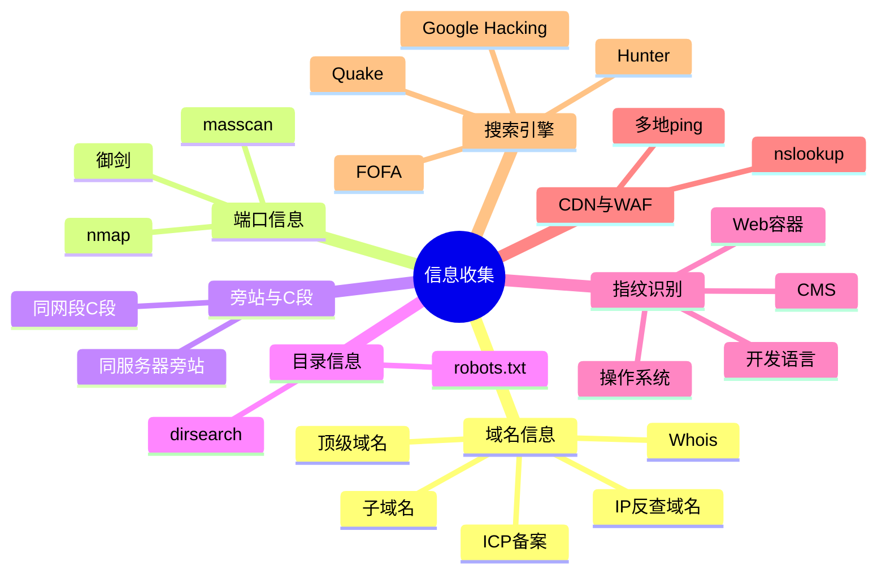

---
{"dg-publish":true,"permalink":"/计算机相关技术知识库/05-Web安全/信息收集总览/","title":"信息收集总览","tags":["Web安全/信息收集"],"dg-note-properties":{"title":"信息收集总览","created":"2026-10-19","tags":["Web安全/信息收集"],"aliases":["信息收集","Information Gathering"]}}
---

# 信息收集总览

> [!warning] 合规声明
> 信息收集同样属于攻击行为的一部分，仅可在**授权范围**内进行。未经授权扫描、探测他人资产可能违反《网络安全法》。

信息收集被称作**渗透测试的灵魂**。"知己知彼，百战不殆"——掌握的信息比对手更多、更详细，就占据了先机。

## 要回答的问题

以一个目标网站为例，信息收集需要逐步回答：

| 问题 | 收集内容 |
|------|---------|
| 这个网站是谁的？ | 注册人 / 机构、Whois、ICP 备案 |
| 该机构还有哪些网站？ | 子域名、同备案主体、IP 反查 |
| 网站用什么技术？ | 编程语言（PHP/JSP）、Web 容器（Apache/IIS）、CMS |
| 后台在哪里？ | 目录扫描、robots.txt、搜索引擎语法 |
| 服务器是什么？ | 操作系统、IP、开放端口、服务版本 |
| 是否有防护？ | CDN、WAF、负载均衡 |

## 收集方向

## 旁站与 C 段

| 概念 | 含义 | 思路 |
|------|------|------|
| **旁站** | 同一台服务器上部署的其他网站（同 IP 不同站点） | 从防护较弱的其他站点入手，拿到服务器权限后自然控制目标站 |
| **C 段** | 同一网段（如 `192.168.1.0/24`）中的其他服务器 | 先控制同网段一台主机，再通过内网横向移动接近目标 |

> [!note] 云服务器的 C 段
> 云服务器的 C 段 IP 通常分属不同用户、相互独立，**没有旁站关系**，不必盲目做 C 段渗透。

## 收集原则

1. **先被动、后主动**：优先使用公开信息（Whois、备案、搜索引擎、测绘平台），再考虑扫描
2. **由外到内**：主域 → 子域 → IP → 端口 → 目录 → 指纹
3. **先面后点**：先摸清资产范围，再针对重点目标深入
4. **全程记录**：域名、IP、端口、指纹、时间点都要留档，方便复测与写报告

## 相关笔记

- [[计算机相关技术知识库/05-Web安全/域名信息收集\|域名信息收集]] — 域名、Whois、备案、子域名
- [[计算机相关技术知识库/05-Web安全/端口扫描\|端口扫描]] — nmap 与 masscan
- [[计算机相关技术知识库/05-Web安全/目录信息收集\|目录信息收集]] — dirsearch 与 robots.txt
- [[计算机相关技术知识库/05-Web安全/网站指纹识别与 CDN\|网站指纹识别与 CDN]] — 识别技术栈与 CDN
- [[计算机相关技术知识库/05-Web安全/网络空间搜索引擎语法\|网络空间搜索引擎语法]] — Google / FOFA / Quake / Hunter
- [[计算机相关技术知识库/04-速查表/信息收集速查\|信息收集速查]] — 工具与命令速查
- [[计算机相关技术知识库/04-速查表/搜索语法速查\|搜索语法速查]] — Google / FOFA 语法速查
- [[计算机相关技术知识库/05-Web安全/XSS 原理与分类\|XSS 原理与分类]] — 从输出回显点发现 XSS
- [[计算机相关技术知识库/05-Web安全/XSS 利用与防御\|XSS 利用与防御]] — XSS 利用链
- [[计算机相关技术知识库/05-Web安全/暴力破解原理\|暴力破解原理]] — 找到登录入口后的认证攻击
- [[计算机相关技术知识库/05-Web安全/Web 渗透测试概览\|Web 渗透测试概览]] — 渗透流程总览
