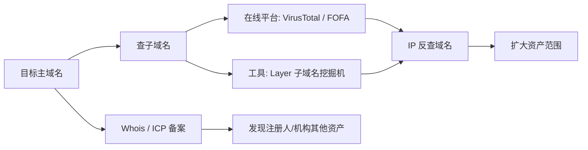

---
{"dg-publish":true,"permalink":"/计算机相关技术知识库/05-Web安全/域名信息收集/","title":"域名信息收集","tags":["Web安全/信息收集"],"dg-note-properties":{"title":"域名信息收集","created":"2026-10-19","tags":["Web安全/信息收集"],"aliases":["域名查询","Whois","ICP 备案"]}}
---


# 域名信息收集

> [!warning] 合规声明
> 仅对已授权目标进行信息收集，不得用于骚扰、社工或侵犯他人隐私。

## 什么是域名

**域名（Domain Name）**是由一串用点分隔的名字组成的 Internet 上某台计算机或计算机组的名称，用于数据传输时对计算机的定位标识。

- 计算机并不认识域名，域名只是为了**方便人记忆**而创建
- DNS（Domain Name System）负责把域名映射为 IP 地址
- 域名解析示例：`secdriver.com` → DNS 服务器 `114.114.114.114` → `47.94.98.63`

```bash
ping secdriver.com        # 借助 ping 做 DNS 解析
nslookup secdriver.com    # 查询域名对应的 IP
```

## 域名级别

| 级别 | 说明 | 示例 |
|------|------|------|
| 顶级域名（国家） | nTLDs，按 ISO 3166 国家代码分配 | 中国 `.cn`、美国 `.us`、日本 `.jp` |
| 顶级域名（国际） | iTDs，表示机构性质 | `.com` 企业、`.net` 网络提供商、`.org` 非营利、`.top` 个人 |
| 二级域名 | 顶级域名之下的注册人名称 | `.ibm`、`.yahoo`、`.microsoft` |
| 三级域名 | 字母、数字、连接符组成 | `www.example.com` 中的 `www` |

> [!info] 长度限制
> 三级域名长度不超过 20 个字符；单个域名标签最多注册 63 个字符；域名总长度不超过 253 个字符。

## 子域名

**子域名（Subdomain）**是域名系统中属于更高一层域的域。例如 `mail.example.com`、`calendar.example.com` 都是 `example.com` 的子域。

```text
主域名：secdriver.com
子域名：
  www.secdriver.com
  edu.secdriver.com
  mail.secdriver.com
  ctf.secdriver.com
  ...
```

> [!tip] 为什么先打子域
> 目标规模较大时，主域通常是重点防护区域。先从防护较弱的子域进入，再想办法迂回接近真正的目标，往往更有效。

## IP 反查域名

通过 IP 反查绑定在该 IP 上的域名，可以发现更多资产：

| 平台 | 地址 |
|------|------|
| ip138 | https://site.ip138.com/ |
| webscan | https://www.webscan.cc/ |
| VirusTotal | https://www.virustotal.com |
| 微步在线 | https://x.threatbook.cn/ |

## Whois 查询

Whois 是域名注册时留下的信息，例如管理员姓名、电话、邮箱。知道目标域名后，第一步通常是获取 Whois 信息：

- 注册人可能就是网站管理员，可据此判断是否注册了其他域名，扩大攻击面
- 可了解域名服务商、拥有者、邮箱、电话、地址等

| 查询网站 | 地址 |
|---------|------|
| 爱站工具网 | https://whois.aizhan.com |
| 站长之家 | http://whois.chinaz.com |
| VirusTotal | https://www.virustotal.com |

## ICP 备案信息查询

网站备案是网站所有者向国家有关部门申请的备案，主要针对**国内网站**；搭建在其他国家的网站不需要备案。

| 平台 | 地址 |
|------|------|
| 工业和信息化部政务服务平台 | https://beian.miit.gov.cn/ |
| 全国互联网安全管理平台 | http://www.beian.gov.cn/portal/recordQuery |
| 天眼查 | http://www.tianyancha.com |

## 子域名收集

| 方式 | 工具 / 平台 |
|------|------------|
| 在线查询 | VirusTotal https://www.virustotal.com/gui/home/search |
| 在线查询 | FOFA https://fofa.info/ |
| 工具扫描 | Layer 子域名挖掘机 |

## 收集流程



## 相关笔记

- [[计算机相关技术知识库/05-Web安全/信息收集总览\|信息收集总览]] — 信息收集整体方向
- [[计算机相关技术知识库/05-Web安全/端口扫描\|端口扫描]] — 拿到 IP 后的下一步
- [[计算机相关技术知识库/05-Web安全/网站指纹识别与 CDN\|网站指纹识别与 CDN]] — 识别域名背后的技术栈
- [[计算机相关技术知识库/05-Web安全/网络空间搜索引擎语法\|网络空间搜索引擎语法]] — 用 FOFA 等平台查子域名与资产
- [[计算机相关技术知识库/04-速查表/信息收集速查\|信息收集速查]] — 工具速查
- [[计算机相关技术知识库/04-速查表/搜索语法速查\|搜索语法速查]] — Google / FOFA 语法速查
- [[计算机相关技术知识库/05-Web安全/Web 渗透测试概览\|Web 渗透测试概览]] — 渗透流程总览
