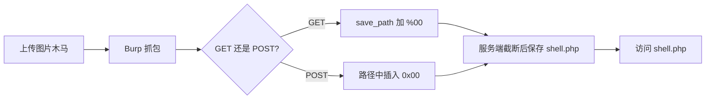

---
{"dg-publish":true,"permalink":"/计算机相关技术知识库/05-Web安全/文件上传 00 截断/","title":"文件上传 00 截断","tags":["Web安全/文件上传"],"dg-note-properties":{"title":"文件上传 00 截断","created":"2026-10-19","tags":["Web安全/文件上传"],"aliases":["00 截断","空字节截断","Pass-12","Pass-13"]}}
---


# 文件上传 00 截断

> [!warning] 合规声明
> 本文操作均在 upload-labs 靶场完成，仅用于授权教学与防御学习。

## 原理

PHP 的一些函数底层是 C 语言实现。C 语言的字符串以 `\0`（0x00）作为**结束标志**，遇到 `0x00` 会认为字符串到此结束，后续内容被截断。

- `0x` 表示十六进制
- URL 中的 `%00` 解码后就是 `0x00`

如果在文件名或保存路径中插入 `%00`，服务端在做扩展名检查时可能只看到前面的内容，而实际写入文件时也按截断后的名称处理，从而绕过限制。

## 利用条件

| 条件 | 要求 |
|------|------|
| PHP 版本 | **< 5.3.4** 才可进行 00 截断 |
| `magic_quotes_gpc` | **Off** |
| 上传点 | 文件名 / 保存路径可控 |

> [!warning] 版本限制
> PHP 5.3.4 及以上版本已经修复了空字节截断问题，现代环境中该手法通常不再有效。

## 一、GET 方式截断（Pass-12）

### 环境

- 靶场：upload-labs（Windows）
- 工具：Burp Suite
- 关卡：Pass-12

### 必要配置

1. 切换 PHP 版本到 **< 5.3.4**
2. 修改 `php.ini`：

```ini
magic_quotes_gpc = Off
```

### 步骤

1. 上传 PHP 木马，使用 Burp 抓包
2. 修改请求参数：

```text
save_path=../upload/shell.php%00
filename=a.png
```

3. 放行上传
4. 访问 `shell.php` 即可

> [!tip] 为什么是 `%00`
> 服务端拼接路径时，扩展名检查看到的是 `shell.php`，但后续 C 字符串函数在 `%00` 处截断，最终写入的是 `shell.php`，而上传的图片后缀 `a.png` 被截掉。

## 二、POST 方式截断（Pass-13）

### 原理

原理与 GET 方式相同，只是参数通过 POST 提交。

### 环境与配置

- 靶场：upload-labs（Windows）
- 工具：Burp Suite
- 关卡：Pass-13
- PHP < 5.3.4，`magic_quotes_gpc = Off`

### 步骤

1. 上传 PHP 木马，使用 Burp 抓包
2. 修改路径参数为 `../upload/a.php.png`，`filename=a.png`
3. 在 `php` 与 `.png` 之间插入 `%00`：
   - 在 Burp 的 Hex 视图中，把光标处的一个空格改成 `00`
   - 或在 Repeater 中直接发送原始字节 `0x00`
4. 上传成功，访问 `a.php` 即可

```text
../upload/a.php%00.png
```

> [!important] 必须是原始空字节
> 需要发送的是真实的 `0x00` 字节，而不是字符串 `"%00"` 三个字符。Burp 的 Hex 编辑功能可以精确插入。

## 流程对比

| 项目 | GET 截断（Pass-12） | POST 截断（Pass-13） |
|------|-------------------|---------------------|
| 传参方式 | URL 查询参数 | 请求体 |
| 关键参数 | `save_path` | `save_path` / `filename` |
| 构造示例 | `save_path=../upload/shell.php%00` | `../upload/a.php%00.png` |
| 前提 | PHP < 5.3.4，magic_quotes_gpc = Off | 同上 |



## 防御要点

| 措施 | 说明 |
|------|------|
| 升级 PHP | 使用受支持的 PHP 版本（5.3.4+ 已修复） |
| 关闭危险配置 | `magic_quotes_gpc = Off` 只是利用条件，不是防御手段 |
| 校验规范化 | 对文件名做规范化，拒绝包含空字节、控制字符的名称 |
| 白名单 + 重命名 | 服务端生成文件名，不接受用户提供的路径 |
| 禁止目录穿越 | 校验最终路径必须位于上传目录内 |
| 上传目录禁止执行 | 即使写入脚本也无法运行 |

## 相关笔记

- [[计算机相关技术知识库/05-Web安全/文件上传漏洞与一句话木马\|文件上传漏洞与一句话木马]] — 漏洞成因与一句话木马
- [[计算机相关技术知识库/05-Web安全/文件上传前端与 MIME 绕过\|文件上传前端与 MIME 绕过]] — Pass-01 / Pass-02
- [[计算机相关技术知识库/05-Web安全/文件上传扩展名绕过\|文件上传扩展名绕过]] — 黑名单与解析绕过
- [[计算机相关技术知识库/05-Web安全/Webshell 管理工具\|Webshell 管理工具]] — 蚁剑连接
- [[计算机相关技术知识库/04-速查表/文件上传绕过速查\|文件上传绕过速查]] — 绕过手法速查
- [[计算机相关技术知识库/05-Web安全/Web 渗透测试概览\|Web 渗透测试概览]] — 渗透流程总览
