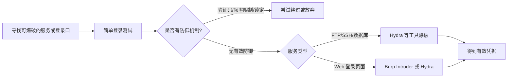

---
{"dg-publish":true,"permalink":"/计算机相关技术知识库/05-Web安全/暴力破解原理/","title":"暴力破解原理","tags":["Web安全/暴力破解"],"dg-note-properties":{"title":"暴力破解原理","created":"2026-10-19","tags":["Web安全/暴力破解"],"aliases":["暴力破解","Brute Force","弱口令"]}}
---


# 暴力破解原理

> [!warning] 合规声明
> 暴力破解仅可在授权目标或本地靶场进行。对真实系统进行口令尝试可能构成违法。

## 什么是暴力破解

"暴力破解"是一种攻击手段。在 Web 攻击中，通常用于获取应用系统的认证信息：**使用大量认证信息在认证接口进行尝试登录，直到得到正确结果**。为了提高效率，一般配合字典和自动化工具进行。

理论上大多数系统都可以被暴力破解，只要有足够的计算能力和时间。因此判断一个系统是否存在暴力破解漏洞并不是绝对的——通常指该系统**没有采用或采用了较弱的认证安全策略**，导致被破解的"可能性"较高。

## 漏洞成因

| 成因 | 说明 |
|------|------|
| **密码复杂度太低** | 长度过短、构成元素单一、有规律或包含个人信息 |
| **未对登录进行限制** | 没有验证码、没有登录频率限制、试错次数过多也不锁定账号，可无限次尝试 |

## 危害

1. 未经用户授权登录其账户进行操作
2. 未经授权访问业务系统（FTP 服务、网站管理后台）
3. 危害数据安全（数据库口令被破解）
4. 危害服务器安全（SSH 口令被破解）

## 一般攻击步骤



1. 寻找可能进行暴力破解的服务或登录口
2. 进行简单登录测试，判断是否有防御机制、能否爆破
3. 服务类（SSH / FTP 等）使用 Hydra 等工具
4. Web 页面使用 Hydra 或 Burp Suite

## 弱口令爆破

使用字典文件进行爆破。字典多为经验积累，包含常见的字符组合。

```text
常见弱口令：123456、password、admin、admin123、qwerty、000000、abc123 ...
```

> [!tip] 字典来源
> 可结合目标信息（姓名、生日、公司名、域名）生成针对性字典；也常用公开的常见口令字典。字典质量往往比工具速度更决定成败。

## 防御要点

| 防御措施 | 说明 |
|---------|------|
| 强密码策略 | 足够长度、多字符类型、禁止常见弱口令 |
| 验证码 | 服务端校验、一次性使用、绑定会话 |
| 登录频率限制 | 同一 IP / 账号单位时间内限制尝试次数 |
| 账号锁定 | 连续失败达到阈值后临时锁定 |
| 多因素认证（MFA） | 密码之外增加第二因素 |
| 登录审计与告警 | 监控异常登录来源、时间、频率 |
| 统一错误提示 | 不区分"用户名不存在"与"密码错误"，减少信息泄露 |

## 相关笔记

- [[计算机相关技术知识库/05-Web安全/Burp 表单暴力破解实战\|Burp 表单暴力破解实战]] — 用 Burp Intruder 爆破登录表单
- [[计算机相关技术知识库/05-Web安全/验证码与 Token 绕过\|验证码与 Token 绕过]] — 常见防护的绕过思路
- [[计算机相关技术知识库/05-Web安全/Burp Intruder 模块\|Burp Intruder 模块]] — 四种攻击模式
- [[计算机相关技术知识库/05-Web安全/信息收集总览\|信息收集总览]] — 先找到登录入口
- [[计算机相关技术知识库/04-速查表/Burp Suite 速查\|Burp Suite 速查]] — 爆破操作速查
- [[计算机相关技术知识库/05-Web安全/Web 渗透测试概览\|Web 渗透测试概览]] — 渗透流程总览
