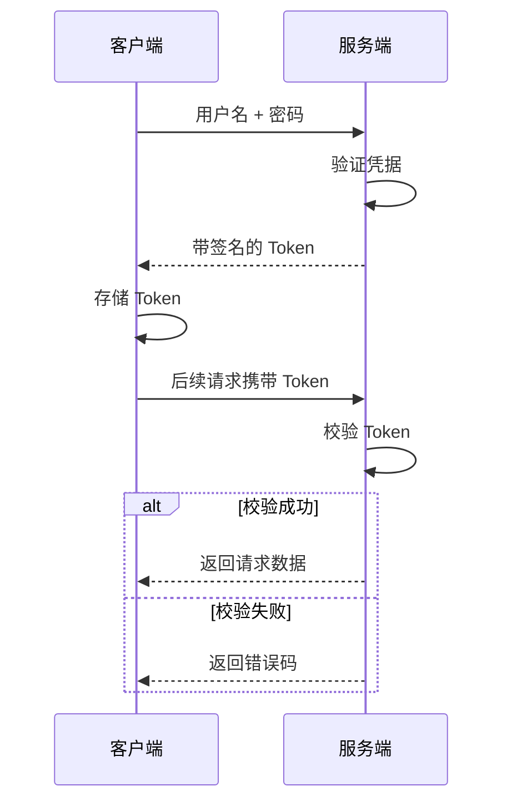

---
{"dg-publish":true,"permalink":"/计算机相关技术知识库/05-Web安全/验证码与 Token 绕过/","title":"验证码与 Token 绕过","tags":["Web安全/暴力破解"],"dg-note-properties":{"title":"验证码与 Token 绕过","created":"2026-10-19","tags":["Web安全/暴力破解"],"aliases":["验证码绕过","Token 防爆破","Recursive grep"]}}
---

# 验证码与 Token 绕过

> [!warning] 合规声明
> 本文所有操作均在 pikachu / DVWA 本地靶场完成，仅用于授权教学与防御学习。

验证码和 Token 是常见的**防暴力破解**手段。但如果实现不当，仍然可以被绕过。

## 一、验证码绕过（one server / 服务端）

### 现象

登录页面多了验证码，使用 Burp 抓包后：

- 重复发送同一个请求多次，验证码都能通过
- 说明服务端虽然显示了验证码，但**没有真正校验**或校验结果没有与会话绑定

### 利用

验证码不起作用时，直接按普通表单爆破流程处理：

1. 抓取登录请求
2. 发送到 Intruder
3. 爆破用户名和密码
4. 按响应长度找到不同的一行

## 二、验证码绕过（on client / 客户端）

### 现象

题目提示验证码在客户端校验。查看页面 JS 源码，可以确认验证逻辑在前端。

### 利用方式

| 方法 | 说明 |
|------|------|
| 删除验证码字段 | 抓包后，在发送前把请求里的验证码参数整段删除 |
| 禁用浏览器 JS | 禁用 JS 后验证码校验逻辑不执行（部分场景验证码也不会显示） |

删除字段后，如果服务端并未再次校验，即可继续按普通流程爆破用户名和密码。

> [!important] 根因
> 客户端验证码只是"用户体验层"的校验。**任何只在前端执行的验证，都等于没有验证**，因为攻击者可以完全控制浏览器与请求。

## 三、Token 防爆破

### Token 是什么

**引入背景**：客户端频繁向服务端请求数据，服务端频繁查询数据库比对用户名和密码。为了减轻服务器压力，Token 应运而生。

**定义**：Token 是服务端生成的一串字符串，作为客户端请求的令牌。第一次登录成功后，服务器生成 Token 并返回给客户端；之后客户端只需携带 Token 请求数据。

**目的**：减轻服务器压力，减少频繁查询数据库，使服务器更健壮。

### Token 认证过程

> [!note] Token 防爆破的原理
> 如果每次登录请求都要求携带**上一次响应中动态生成的新 Token**，那么自动化工具就不能简单地重复同一个请求。必须先从每次响应中提取最新 Token，再拼接到下一次请求中。

## 四、DVWA High 级别 Token 爆破

以 DVWA Brute Force 的 high 级别为例：

### Step 1：调整难度

将 DVWA 安全级别设为 **high**，进入 **Brute Force**。

### Step 2：抓包

输入正确的账号和一个假密码，使用 Burp 拦截请求。

请求中会同时包含 `password`、`user_token` 等字段。

### Step 3：发送到 Intruder

`Ctrl + I` 将请求发送到 Intruder：

- 攻击模式选择 **Pitchfork**
- 标记两个插入点：密码、`user_token`

### Step 4：配置 Payloads

| Payload set | 类型 | 配置 |
|-------------|------|------|
| Payload set 1（密码） | Simple list | 添加密码字典 |
| Payload set 2（token） | **Recursive grep** | 从 response 中提取 `user_token`，用于替换本次请求 |

**Recursive grep（递归查询）**：从响应中提取数据（如 `user_token`），自动作为下一次请求的 payload。

### Step 5：配置 Options

| 选项 | 设置 |
|------|------|
| Request Engine → 线程数 | **1**（Token 必须串行，不能并发） |
| Grep - Extract | Add → Refetch response → 选中 token 值，自动确定提取范围 |
| Redirections | **Always** |
| Payloads → Initial payload for first request | 填入初始 token 值 |

> [!warning] 为什么线程必须为 1
> Token 是一次性的、与请求顺序绑定。多线程并发会导致多个请求使用同一个 Token，服务端拒绝或会话错乱，爆破必然失败。

### Step 6：开始攻击与结果判断

点击 **Start attack**，完成后：

- 按 **Length** 排序，排在最前面的很可能就是正确密码
- 也可通过 `Options → Grep - Match` 添加"登录成功"等关键字，自动标记命中项

## 防御要点

| 措施 | 说明 |
|------|------|
| 服务端校验验证码 | 验证码必须在服务端验证，且一次性使用 |
| 验证码绑定会话 | 验证码与会话/IP 绑定，防止复用 |
| Token 一次性 | 每次请求后使旧 Token 失效 |
| Token 绑定会话 | Token 与用户会话、来源绑定，防止被工具复用 |
| 频率限制与锁定 | 限制单位时间尝试次数，失败过多锁定 |
| 统一错误信息 | 不泄露账号是否存在 |

## 相关笔记

- [[计算机相关技术知识库/05-Web安全/暴力破解原理\|暴力破解原理]] — 爆破基础
- [[计算机相关技术知识库/05-Web安全/Burp Suite 入门\|Burp Suite 入门]] — 代理配置与模块总览
- [[计算机相关技术知识库/05-Web安全/Burp 表单暴力破解实战\|Burp 表单暴力破解实战]] — 普通表单爆破
- [[计算机相关技术知识库/05-Web安全/Burp Intruder 模块\|Burp Intruder 模块]] — Pitchfork 与四种模式
- [[计算机相关技术知识库/05-Web安全/Burp Proxy 模块\|Burp Proxy 模块]] — 抓包与改包
- [[计算机相关技术知识库/04-速查表/Burp Suite 速查\|Burp Suite 速查]] — Token 爆破配置速查
- [[计算机相关技术知识库/05-Web安全/Web 渗透测试概览\|Web 渗透测试概览]] — 渗透流程总览
