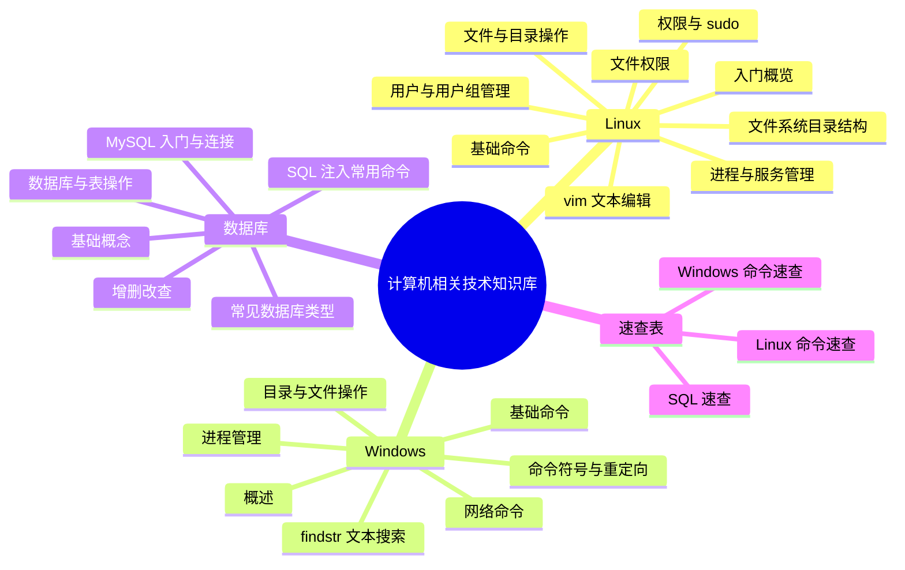

# 计算机相关技术知识库

> [!abstract] 关于本知识库
> 本知识库整理自 4 份培训课件（Linux 基础 ×2、Windows 操作系统、数据库），涵盖 **Linux**、**Windows**、**数据库/MySQL** 三大方向的基础知识与常用命令，适合入门学习与日常速查。
> 原始课件保存在 [[参考资料索引]] 中，可随时对照原文。

## 🐧 Linux

- [[Linux 入门概览]] — 起源、发行版、虚拟机与 SSH 远程连接工具
- [[Linux 基础命令]] — 快捷键、系统信息查看
- [[Linux 用户与用户组管理]] — useradd / usermod / userdel / groupadd / passwd
- [[Linux 权限与 sudo]] — root、su、sudo 与四大配置文件
- [[Linux 文件与目录操作]] — ls / mkdir / cp / rm / mv / 查看文件
- [[Linux 文件系统目录结构]] — /etc、/home、/var 等核心目录速览
- [[Linux 文件权限]] — rwx 三组权限与 chmod 数字模式
- [[Linux vim 文本编辑]] — 命令模式 / 输入模式 / 末行模式
- [[Linux 进程与服务管理]] — ps、top、kill 与 systemctl

## 🪟 Windows

- [[Windows 概述]] — 操作系统概念与 Windows 发展史
- [[Windows 基础命令]] — cls、whoami、systeminfo、内置账户一览
- [[Windows 目录与文件操作]] — dir、cd、rd、copy、xcopy、move、del
- [[Windows findstr 文本搜索]] — 常用参数详解
- [[Windows 进程管理]] — tasklist 与 taskkill
- [[Windows 网络命令]] — ipconfig、ping、netstat
- [[Windows 命令符号与重定向]] — &、&&、||、|、>、>>、<

## 🗄️ 数据库

- [[数据库基础概念]] — 优点、库/表/字段/记录、SQL
- [[常见数据库类型]] — MySQL、SQL Server、Oracle、MongoDB
- [[MySQL 入门与连接]] — 简介、phpstudy、命令行登录
- [[MySQL 数据库与表操作]] — create / alter / desc / drop
- [[MySQL 增删改查]] — insert、select、delete、update、union
- [[SQL 注入常用命令]] — 常用函数与注入探测命令

## ⚡ 速查表

- [[Linux 命令速查]]
- [[Windows 命令速查]]
- [[SQL 速查]]

## 📚 参考资料与维护

- [[参考资料索引]] — 4 份原始课件 PDF（已内嵌可在线阅读）
- [[知识库全景]] — 画布版知识地图
- [[知识库目录]] — 全部笔记的表格视图（Bases 自动生成）
- [[维护指南]] — 新增/修改/重命名笔记的标准流程与命名约定

> [!tip] 持续扩充
> 本知识库会不断补充与优化。新增笔记、新增分区、重命名的具体步骤见 [[维护指南]]。
