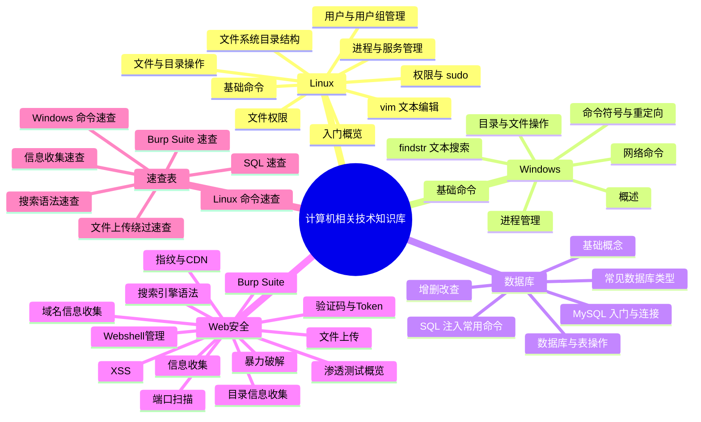

---
{"dg-publish":true,"permalink":"/计算机相关技术知识库/首页/","title":"首页","tags":["索引","gardenEntry"],"dg-note-properties":{"title":"首页","created":"2026-10-13","tags":["索引","gardenEntry"],"aliases":["计算机相关技术知识库","Home"]}}
---

# 计算机相关技术知识库

> [!abstract] 关于本知识库
> 本知识库整理自 11 份培训课件（Linux 基础 ×2、Windows 操作系统、数据库、Burp Suite、信息收集、XSS、文件上传 ×2、暴力破解 ×2），涵盖 **Linux**、**Windows**、**数据库/MySQL**、**Web 安全** 四大方向的基础知识与常用命令，适合入门学习与日常速查。
> 原始课件保存在 [[计算机相关技术知识库/99-参考资料/参考资料索引\|参考资料索引]] 中，可随时对照原文。

## 🐧 Linux

- [[计算机相关技术知识库/01-Linux/Linux 入门概览\|Linux 入门概览]] — 起源、发行版、虚拟机与 SSH 远程连接工具
- [[计算机相关技术知识库/01-Linux/Linux 基础命令\|Linux 基础命令]] — 快捷键、系统信息查看
- [[计算机相关技术知识库/01-Linux/Linux 用户与用户组管理\|Linux 用户与用户组管理]] — useradd / usermod / userdel / groupadd / passwd
- [[计算机相关技术知识库/01-Linux/Linux 权限与 sudo\|Linux 权限与 sudo]] — root、su、sudo 与四大配置文件
- [[计算机相关技术知识库/01-Linux/Linux 文件与目录操作\|Linux 文件与目录操作]] — ls / mkdir / cp / rm / mv / 查看文件
- [[计算机相关技术知识库/01-Linux/Linux 文件系统目录结构\|Linux 文件系统目录结构]] — /etc、/home、/var 等核心目录速览
- [[计算机相关技术知识库/01-Linux/Linux 文件权限\|Linux 文件权限]] — rwx 三组权限与 chmod 数字模式
- [[计算机相关技术知识库/01-Linux/Linux vim 文本编辑\|Linux vim 文本编辑]] — 命令模式 / 输入模式 / 末行模式
- [[计算机相关技术知识库/01-Linux/Linux 进程与服务管理\|Linux 进程与服务管理]] — ps、top、kill 与 systemctl

## 🪟 Windows

- [[计算机相关技术知识库/02-Windows/Windows 概述\|Windows 概述]] — 操作系统概念与 Windows 发展史
- [[计算机相关技术知识库/02-Windows/Windows 基础命令\|Windows 基础命令]] — cls、whoami、systeminfo、内置账户一览
- [[计算机相关技术知识库/02-Windows/Windows 目录与文件操作\|Windows 目录与文件操作]] — dir、cd、rd、copy、xcopy、move、del
- [[计算机相关技术知识库/02-Windows/Windows findstr 文本搜索\|Windows findstr 文本搜索]] — 常用参数详解
- [[计算机相关技术知识库/02-Windows/Windows 进程管理\|Windows 进程管理]] — tasklist 与 taskkill
- [[计算机相关技术知识库/02-Windows/Windows 网络命令\|Windows 网络命令]] — ipconfig、ping、netstat
- [[计算机相关技术知识库/02-Windows/Windows 命令符号与重定向\|Windows 命令符号与重定向]] — &、&&、||、|、>、>>、<

## 🗄️ 数据库

- [[计算机相关技术知识库/03-数据库/数据库基础概念\|数据库基础概念]] — 优点、库/表/字段/记录、SQL
- [[计算机相关技术知识库/03-数据库/常见数据库类型\|常见数据库类型]] — MySQL、SQL Server、Oracle、MongoDB
- [[计算机相关技术知识库/03-数据库/MySQL 入门与连接\|MySQL 入门与连接]] — 简介、phpstudy、命令行登录
- [[计算机相关技术知识库/03-数据库/MySQL 数据库与表操作\|MySQL 数据库与表操作]] — create / alter / desc / drop
- [[计算机相关技术知识库/03-数据库/MySQL 增删改查\|MySQL 增删改查]] — insert、select、delete、update、union
- [[计算机相关技术知识库/03-数据库/SQL 注入常用命令\|SQL 注入常用命令]] — 常用函数与注入探测命令

## 🛡️ Web 安全

> [!warning] 合规声明
> Web 安全分区内容仅用于**授权环境下的安全测试、CTF 竞赛、靶场练习与防御学习**。未经授权扫描、爆破、注入或上传均属违法行为。

- [[计算机相关技术知识库/05-Web安全/Web 渗透测试概览\|Web 渗透测试概览]] — 渗透流程与分区导航

**信息收集**

- [[计算机相关技术知识库/05-Web安全/信息收集总览\|信息收集总览]] — 收集方向、旁站与 C 段
- [[计算机相关技术知识库/05-Web安全/域名信息收集\|域名信息收集]] — 域名级别、Whois、ICP 备案、子域名
- [[计算机相关技术知识库/05-Web安全/端口扫描\|端口扫描]] — nmap、masscan、御剑
- [[计算机相关技术知识库/05-Web安全/目录信息收集\|目录信息收集]] — robots.txt、dirsearch
- [[计算机相关技术知识库/05-Web安全/网站指纹识别与 CDN\|网站指纹识别与 CDN]] — whatweb、Wappalyzer、CDN 判断
- [[计算机相关技术知识库/05-Web安全/网络空间搜索引擎语法\|网络空间搜索引擎语法]] — Google Hacking、FOFA、Quake、Hunter

**Burp Suite**

- [[计算机相关技术知识库/05-Web安全/Burp Suite 入门\|Burp Suite 入门]] — 模块总览、浏览器代理、Repeater
- [[计算机相关技术知识库/05-Web安全/Burp Proxy 模块\|Burp Proxy 模块]] — 拦截、改包、HTTP history
- [[计算机相关技术知识库/05-Web安全/Burp Intruder 模块\|Burp Intruder 模块]] — Sniper / Battering Ram / Pitchfork / Cluster Bomb

**暴力破解**

- [[计算机相关技术知识库/05-Web安全/暴力破解原理\|暴力破解原理]] — 成因、危害、攻击步骤
- [[计算机相关技术知识库/05-Web安全/Burp 表单暴力破解实战\|Burp 表单暴力破解实战]] — 登录包拦截与结果判断
- [[计算机相关技术知识库/05-Web安全/验证码与 Token 绕过\|验证码与 Token 绕过]] — 客户端/服务端验证码、Token 防爆破

**XSS**

- [[计算机相关技术知识库/05-Web安全/XSS 原理与分类\|XSS 原理与分类]] — 反射型、存储型、DOM 型
- [[计算机相关技术知识库/05-Web安全/XSS 利用与防御\|XSS 利用与防御]] — Cookie 窃取与防御要点

**文件上传**

- [[计算机相关技术知识库/05-Web安全/文件上传漏洞与一句话木马\|文件上传漏洞与一句话木马]] — 漏洞成因、PHP 一句话
- [[计算机相关技术知识库/05-Web安全/Webshell 管理工具\|Webshell 管理工具]] — 蚁剑、冰蝎、菜刀、哥斯拉
- [[计算机相关技术知识库/05-Web安全/文件上传前端与 MIME 绕过\|文件上传前端与 MIME 绕过]] — Pass-01、Pass-02
- [[计算机相关技术知识库/05-Web安全/文件上传扩展名绕过\|文件上传扩展名绕过]] — 黑名单与解析技巧
- [[计算机相关技术知识库/05-Web安全/文件上传 00 截断\|文件上传 00 截断]] — GET/POST 截断

## ⚡ 速查表

- [[计算机相关技术知识库/04-速查表/Linux 命令速查\|Linux 命令速查]]
- [[计算机相关技术知识库/04-速查表/Windows 命令速查\|Windows 命令速查]]
- [[计算机相关技术知识库/04-速查表/SQL 速查\|SQL 速查]]
- [[计算机相关技术知识库/04-速查表/信息收集速查\|信息收集速查]]
- [[计算机相关技术知识库/04-速查表/搜索语法速查\|搜索语法速查]]
- [[计算机相关技术知识库/04-速查表/Burp Suite 速查\|Burp Suite 速查]]
- [[计算机相关技术知识库/04-速查表/文件上传绕过速查\|文件上传绕过速查]]

## 📚 参考资料与维护

- [[计算机相关技术知识库/99-参考资料/参考资料索引\|参考资料索引]] — 11 份原始课件 PDF（已内嵌可在线阅读）
- [[计算机相关技术知识库/知识库全景.canvas\|知识库全景]] — 画布版知识地图
- [[知识库目录]] — 全部笔记的表格视图（Bases 自动生成）
- [[计算机相关技术知识库/维护指南\|维护指南]] — 新增/修改/重命名笔记的标准流程与命名约定

> [!tip] 持续扩充
> 本知识库会不断补充与优化。新增笔记、新增分区、重命名的具体步骤见 [[计算机相关技术知识库/维护指南\|维护指南]]。
